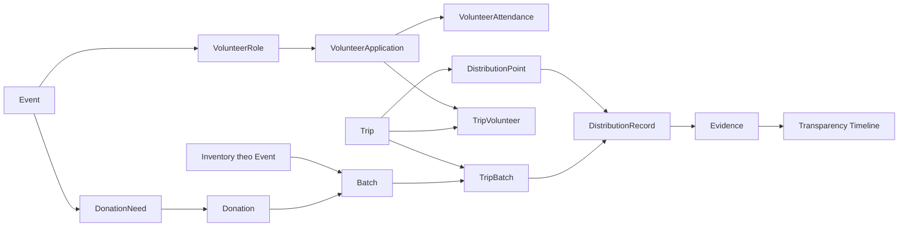

# Kiến trúc nền tảng OpenAid

Bộ đầu vào chi tiết cho System Context, Use Case, Architecture, Component, ERD, Business/Data Flow, Sequence và Deployment nằm tại [diagrams/README.md](diagrams/README.md). Bộ này tách cấu trúc hiện có, thiết kế MVP và các quyết định còn cần chốt.

Đây là khung backend theo proposal C1SE.102, tập trung vào ba miền Volunteer Management, Donation and Inventory, Distribution and Transparency. Dự án dùng Modular Monolith với một NestJS application và một PostgreSQL database.

## Trạng thái triển khai

Các module nghiệp vụ đã có controller, service, DTO và ranh giới truy cập dữ liệu. Chúng trả HTTP 501 qua `featureNotImplemented`, kèm mã yêu cầu FR cần triển khai. Repository nghiệp vụ là khung để bổ sung truy vấn có phạm vi và các hàm ghi nhận transaction.

Auth/profile sẵn có được giữ lại, chuẩn hóa `systemRole` và dùng chung cấu hình HTTP. Storage là interface kèm adapter placeholder. Các file Docker, CI và initial migration là nền tảng để kiểm tra tiếp, không thể hiện sản phẩm đã hoàn chỉnh.

## Ranh giới module

| Module            | Entity hoặc trách nhiệm                               |
| ----------------- | ----------------------------------------------------- |
| auth, users       | User, JWT, hồ sơ, systemRole                          |
| organizations     | Organization, OrganizationMember, quyền theo tổ chức  |
| events            | Event, VolunteerRole, DonationNeed, ItemType, Unit    |
| volunteers        | VolunteerApplication, VolunteerAttendance             |
| donations         | Donation và Tracking ID                               |
| inventory         | Inventory theo Event, loại hàng, đơn vị               |
| batches           | Batch và việc liên kết nguyên Donation                |
| trips             | Trip, TripVolunteer, TripBatch                        |
| distribution      | DistributionPoint, DistributionRecord                 |
| evidence, storage | Metadata, lưu ảnh, xác nhận riêng tư, duyệt công khai |
| transparency      | TransparencyLog, public DTO, timeline                 |
| dashboard         | Truy vấn tổng hợp, báo cáo cuối chương trình          |
| admin             | Quản trị tài khoản, tổ chức và moderation             |
| health            | Liveness của ứng dụng                                 |

Controller nhận DTO và người dùng hiện tại; service điều phối use case, phân quyền và trạng thái; repository chỉ xử lý dữ liệu. Các repository được giữ trong module của mình. Chỉ export service hoặc interface cần dùng bởi module khác.

Không thêm module cho từng bảng liên kết. Không có Report entity, notification, GPS, payment, AI hay blockchain trong khung MVP.

## Vai trò

- `User.systemRole`: USER hoặc ADMIN.
- `OrganizationMember.role`: MEMBER hoặc ORGANIZER, giới hạn theo organizationId.
- Volunteer/Donor được xác định qua Application/Donation, không phải role cố định.
- `TripVolunteer.role`: LEADER hoặc MEMBER của một chuyến đi.

JWT và kiểm tra system role được áp dụng toàn cục. Route công khai phải có `@Public()`. `@Roles()` chỉ dành cho system role, không dùng để biểu diễn Organizer.

`OrganizationAccessService` cung cấp `requireOrganizer` và `requireApprovedOrganizer`. Khi triển khai service nghiệp vụ, phải lấy organizationId từ entity đang thao tác rồi gọi kiểm tra quyền tương ứng. Không tin organizationId do client gửi để xác định quyền đối với một entity khác. Quyền đổi trạng thái Trip/Point là Organizer của tổ chức chứa Event hoặc Leader được gán cho Trip; Member chỉ xem và upload bằng chứng trong phạm vi được gán.

## Chuỗi dữ liệu



Donation giữ một `batchId` nullable: không chia một donation cho nhiều batch. Quan hệ này đã đủ thể hiện các donation thuộc batch, nên MVP không có bảng BatchItem trùng với quan hệ đó. Batch chứa đúng một loại hàng và một đơn vị.

Trip dùng bảng nối TripBatch để mang nhiều batch và giữ lịch sử chuyến bị hủy. `unassignedAt` đánh dấu kết thúc một lần gán. TripVolunteer tham chiếu Application của cùng Event. Point có thứ tự và trạng thái độc lập. Một DistributionRecord là một TripBatch tại một Point với số lượng phân phối.

## Ràng buộc đã đặt ở database

- Composite foreign key bảo đảm Donation Need, Donation, Inventory, Batch, Trip và Application được liên kết đúng Event; Donation/Batch/Inventory có cùng loại hàng và đơn vị.
- Donation có tối đa một Batch.
- Mỗi người có tối đa một Application cho một Event; Attendance riêng biệt lưu check-in/check-out.
- Một Batch có tối đa một lần gán Trip đang hoạt động qua partial unique index.
- Mỗi Trip có tối đa một LEADER qua partial unique index. Điều kiện phải có đúng một Leader khi tạo/chạy Trip thuộc service.
- Số lượng dùng Decimal(14,3), hỗ trợ kg và đơn vị lẻ.
- Initial migration bổ sung CHECK cho số lượng không âm, số lượng hợp lệ và phương trình tồn kho.
- Relation nghiệp vụ dùng Restrict để tránh xóa dây chuyền mất lịch sử. Xóa Event Draft cùng dữ liệu con cần một use case riêng, không xóa vật lý Event đã Published.
- Evidence APPROVED phải có privacy confirmation, reviewer và thời gian duyệt.

Initial migration được sinh từ schema rỗng, chưa được tự áp dụng vào database. Partial index và CHECK được khai báo trong SQL vì Prisma schema chưa biểu diễn các ràng buộc này; cần giữ chúng khi chỉnh migration.

## Quy tắc cần triển khai trong service

### Event và Volunteer

FR03–FR11: tạo Organization kèm membership ORGANIZER; chỉ Organization APPROVED được publish Event; đăng ký vai trò đúng Event; Organizer duyệt; attendance chỉ cho Application hợp lệ. Event Discovery chỉ trả trạng thái công khai, hỗ trợ tìm kiếm, khu vực, thời gian và loại hỗ trợ.

### Donation và Inventory

FR12–FR16: resolve Event/loại hàng/đơn vị từ DonationNeed; sinh Tracking ID ngẫu nhiên, xử lý collision của unique key; vượt target chỉ cảnh báo. Tạo Donation phải gắn người đăng nhập để My Donations hoạt động.

Receipt, reserve, distribute và reconcile phải ghi dữ liệu và TransparencyLog trong cùng transaction. Các cập nhật stock phải chịu được thao tác đồng thời và tránh xử lý lại cùng một hành động.

```text
Receipt:       Received += quantity, Available += quantity
Create Batch:  Available -= quantity, Reserved += quantity
Assign Trip:   không đổi số lượng tồn kho
Distribute:    Reserved -= quantity, Distributed += quantity
Return:        Reserved -= quantity, Available += quantity
Write off:     Reserved -= quantity, Lost += quantity

Received = Available + Reserved + Distributed + Lost
```

Batch quantity được tính từ toàn bộ donation được chọn, không nhận tổng số lượng tùy ý từ client. Các donation phải đã nhận, chưa thuộc batch, cùng Event, loại hàng và đơn vị.

### Trip và Distribution

FR17–FR19: người được gán phải có Application APPROVED cho cùng Event, và Trip có đúng một Leader. Kiểm tra quyền Organizer/Leader trước khi thay đổi trạng thái hoặc xác nhận số lượng.

Chỉ hoàn tất Trip khi mọi Point là Distributed/Skipped. Chỉ hủy trước khi có Point Distributed; bỏ gán các TripBatch trong transaction, đưa Batch về Ready và giữ stock Reserved. Tổng phân phối và đối soát theo từng Batch không vượt số lượng Batch. Phải khóa/điều kiện hóa cập nhật phù hợp để tránh phát vượt hàng khi có yêu cầu đồng thời.

### Evidence và Transparency

FR20–FR25: upload → privacy confirmation → Organizer review → public display. Chính sách nền tảng là JPEG/PNG/WebP tối đa 5 MiB; adapter phải kiểm tra nội dung file bên cạnh MIME do client khai báo.

Public Tracking dùng một endpoint `/api/transparency/track/:trackingId` và response DTO riêng. Chỉ công khai evidence có privacyConfirmed và reviewStatus APPROVED; loại thông tin cá nhân, internal notes và actor identity khỏi response công khai.

TransparencyRepository.append nhận `Prisma.TransactionClient` để business service ghi actor, thời gian, oldStatus/newStatus, evidence và chi tiết trong cùng transaction. Timeline phải nối đủ Donation → Batch → Trip → Point → Evidence theo thứ tự thời gian. Không diễn giải một donation cụ thể đã được trao vật lý tại một điểm cụ thể khi hàng đã trộn trong batch.

Dashboard/Report được tạo từ các truy vấn có phạm vi Event/tổ chức, hiển thị Needed, Pledged, Received, Distributed theo loại hàng/đơn vị. Không cộng kg và chai vào cùng một tổng.

## Trạng thái

| Entity          | Luồng cần kiểm tra khi triển khai                                                        |
| --------------- | ---------------------------------------------------------------------------------------- |
| Event           | DRAFT → PUBLISHED → CLOSED; PUBLISHED → CANCELLED                                        |
| Application     | PENDING → APPROVED hoặc REJECTED                                                         |
| Attendance      | Check-in → Check-out, tách khỏi Application status                                       |
| Donation        | PENDING → RECEIVED hoặc REJECTED; RECEIVED → IN_BATCH → DISTRIBUTED; PENDING → CANCELLED |
| Batch           | DRAFT → READY → ASSIGNED → DISTRIBUTED; ASSIGNED → READY khi hủy Trip                    |
| Trip            | SCHEDULED → PREPARING → IN_TRANSIT → COMPLETED; CANCELLED theo điều kiện nghiệp vụ       |
| Point           | PENDING → ARRIVED → DISTRIBUTED; SKIPPED theo điều kiện nghiệp vụ                        |
| Evidence review | PENDING → APPROVED hoặc REJECTED                                                         |

## Thứ tự phát triển

1. Organization membership, quyền theo tổ chức, Event/roles/needs và Discovery.
2. Volunteer application, review và attendance.
3. Donation, My Donations, Tracking ID và receipt vào Inventory.
4. Batch và transaction Available → Reserved.
5. Trip, staffing, points, distribution và đối soát.
6. Evidence storage/review, timeline, public projection và Dashboard/Report.
7. Bộ dữ liệu demo end-to-end, test nghiệp vụ với database riêng và tích hợp frontend.

Mỗi bước cần hoàn tất use case và kiểm thử dữ liệu trước khi nối sang bước tiếp theo. Vitest được giữ theo công cụ đã có trong repository; đồng bộ phần công cụ kiểm thử trong tài liệu dự án khi chốt SRS/Architecture.
