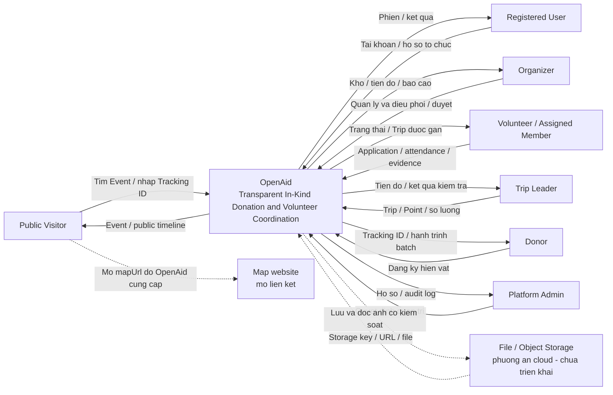

# 01 System Context Diagram

## Mục đích và ranh giới

Hình này trả lời “ai dùng OpenAid, dùng để làm gì và OpenAid trao đổi với hệ thống nào”. Vẽ một software system duy nhất mang tên **OpenAid**. Bên trong không mở thành Next.js, NestJS, database hoặc các module; những chi tiết đó nằm ở phần 03–04.

Nguồn: proposal 1, 6.3, 6.4, 9, 12.1. Đây là **THIẾT KẾ MVP**; không phải chứng nhận toàn bộ kết nối đã hoạt động.

## Actor đặt ngoài ranh giới

| ID  | Nhãn trên hình       | Vai trò và dữ liệu gửi vào OpenAid                                                                        | Kết quả nhận                                                                    |
| --- | -------------------- | --------------------------------------------------------------------------------------------------------- | ------------------------------------------------------------------------------- |
| A01 | Public Visitor       | Tìm Event công khai; nhập Tracking ID, không cần đăng nhập                                                | Thông tin Event; hành trình công khai, trạng thái và evidence được duyệt        |
| A02 | Registered User      | Đăng nhập, cập nhật hồ sơ, đăng ký hồ sơ tổ chức                                                          | Phiên truy cập, hồ sơ và trạng thái tổ chức                                     |
| A03 | Organizer            | Quản lý Event/roles/needs; duyệt application; xác nhận donation; quản lý stock/batch/trip; duyệt evidence | Danh sách điều phối, số liệu kho, timeline nội bộ, Dashboard/Report của tổ chức |
| A04 | Volunteer            | Chọn vai trò, gửi application, check-in/out; tham gia Trip được gán                                       | Trạng thái application, My Activities, nhiệm vụ/chuyến đi                       |
| A05 | Assigned Trip Member | Xem Trip được gán; gửi ảnh và xác nhận riêng tư                                                           | Thông tin Trip và trạng thái evidence của mình                                  |
| A06 | Trip Leader          | Cập nhật Trip/Point và xác nhận số lượng theo Batch                                                       | Tiến độ chuyến, kết quả ghi nhận và các lỗi kiểm tra nghiệp vụ                  |
| A07 | Donor                | Chọn Donation Need, đăng ký số lượng, ảnh tùy chọn                                                        | Tracking ID, My Donations và hành trình batch                                   |
| A08 | Platform Admin       | Duyệt/tạm ngưng tổ chức, quản trị tài khoản, moderation Event ở mức cơ bản                                | Hồ sơ cần duyệt, log và kết quả quản trị                                        |

A05/A06 có thể gộp vào Volunteer trong hình Context tổng quan và ghi note “Leader được cập nhật trạng thái; Member được upload evidence”. Để nguyên các actor này trong Use Case chi tiết.

Organization là đơn vị được quản lý trong dữ liệu. Người tương tác là Organizer; không vẽ “Organization” thành một hệ thống phần mềm bên ngoài nếu không có tích hợp phần mềm tổ chức riêng.

## Hệ thống ngoài và cơ chế hỗ trợ

| ID  | Thành phần                     | Quan hệ                                                                     | Cách thể hiện                                                                                |
| --- | ------------------------------ | --------------------------------------------------------------------------- | -------------------------------------------------------------------------------------------- |
| X01 | File/Object Storage            | OpenAid gửi ảnh; nhận định danh/URL và metadata; phục vụ nội dung được phép | Hệ thống ngoài nếu dùng cloud; với local disk thì bỏ khỏi Context, thể hiện trong Deployment |
| X02 | Map website                    | Người dùng mở mapUrl để xem vị trí                                          | Link mở website; không có gọi API GPS/ETA/routing được xác định                              |
| L01 | QR generation/scanning library | Hỗ trợ check-in bằng mã QR nếu làm                                          | Note bên trong OpenAid; thư viện không phải một actor/hệ thống ngoài                         |
| X03 | GitHub/GitHub Actions          | Lưu source và chạy kiểm tra khi push/PR                                     | Ngoài hình Context nghiệp vụ; đặt ở Deployment/Development view                              |

Không vẽ payment gateway, SMS/email provider hoặc dịch vụ xác minh AI. Chưa có nhu cầu tích hợp tương ứng trong MVP.

## Mũi tên cần có

- A01 → OpenAid: tìm Event, nhập Tracking ID; OpenAid → A01: Event và public timeline.
- A02 → OpenAid: thông tin tài khoản/hồ sơ tổ chức; OpenAid → A02: kết quả xác thực/hồ sơ.
- A03 → OpenAid: khai báo, duyệt, nhận hàng, lập lô/chuyến, review ảnh; OpenAid → A03: dữ liệu điều phối và báo cáo.
- A04/A05 → OpenAid: application, attendance, evidence; OpenAid → A04/A05: kết quả, lịch và thông tin được gán.
- A06 → OpenAid: cập nhật chuyến/điểm, số lượng phát; OpenAid → A06: tiến độ và kiểm tra số lượng.
- A07 → OpenAid: donation; OpenAid → A07: Tracking ID và trạng thái.
- A08 → OpenAid: quyết định quản trị; OpenAid → A08: danh sách cần xử lý/log.
- OpenAid → X01: lưu/đọc file được phép; X01 → OpenAid: storage key/URL/nội dung. Ảnh chưa được duyệt không được phục vụ như tài nguyên công khai — thiết kế cách phục vụ ảnh nằm ở C03.
- A01/A04/A03 → X02: mở link bản đồ do OpenAid cung cấp; đường này không đi vào PostgreSQL.

## Mã Mermaid tham khảo

## Kiểm tra trước khi chốt hình

Đủ Organizer/Volunteer/Donor/Admin/Public Visitor; không dùng actor như các enum cố định; không có thành phần nội bộ lẫn trong Context; nhãn map là mở link; ảnh công khai phải qua privacy/review; OpenAid không tự vận chuyển hàng hoặc quyết định danh sách người thụ hưởng.
