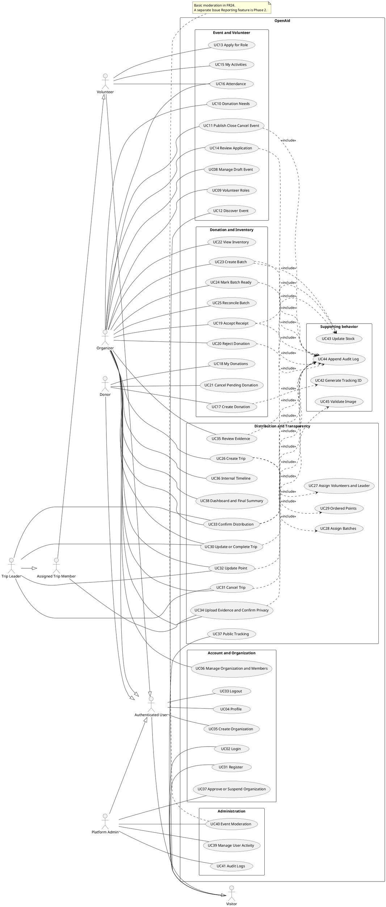

# 02 Use Case Diagram

## Cách tổ chức

Vẽ boundary “OpenAid”. Actor nằm ngoài. Chia use case thành Account and Organization, Event and Volunteer, Donation and Inventory, Distribution and Transparency, Administration. Catalog dưới đây bao phủ FR01–FR26; việc có use case trong hình không có nghĩa endpoint đã được triển khai.

Một số use case như điều chỉnh quyền và ghi audit là hỗ trợ. Nếu hình tổng quan quá lớn, giữ các mục tiêu người dùng và tách include sang hình chi tiết; vẫn giữ catalog đầy đủ trong tài liệu.

## Actor hierarchy

- “Visitor” là người truy cập web, không bắt buộc đăng nhập.
- “Authenticated User” có thể thực hiện hành vi công khai của Visitor.
- Organizer, Volunteer, Donor và Platform Admin chuyên biệt hóa Authenticated User.
- Assigned Trip Member chuyên biệt hóa Volunteer; Trip Leader chuyên biệt hóa Assigned Trip Member.
- Các specialization mô tả vai trò trong tương tác; một tài khoản có thể hiện thực nhiều actor. Admin không mặc nhiên có quyền Organizer của mọi tổ chức.

## Catalog use case

| ID   | Use case                                       | Actor khởi tạo                             | FR         | Tiền điều kiện hoặc kết quả trọng tâm                                                    |
| ---- | ---------------------------------------------- | ------------------------------------------ | ---------- | ---------------------------------------------------------------------------------------- |
| UC01 | Đăng ký tài khoản                              | Visitor                                    | FR01       | Email chưa có; password được hash; systemRole mặc định USER                              |
| UC02 | Đăng nhập                                      | Visitor                                    | FR01       | Tài khoản active; nhận access token                                                      |
| UC03 | Đăng xuất                                      | Authenticated User                         | FR01       | Kết thúc phiên ở client; chính sách thu hồi token cần chốt C01                           |
| UC04 | Xem/cập nhật hồ sơ                             | Authenticated User                         | FR02       | Chỉ hồ sơ của mình                                                                       |
| UC05 | Tạo hồ sơ Organization                         | Authenticated User                         | FR04       | Tạo Organization PENDING và membership ORGANIZER                                         |
| UC06 | Quản lý Organization/membership                | Organizer                                  | FR03, FR04 | Đúng tổ chức; quyền MEMBER/ORGANIZER có phạm vi                                          |
| UC07 | Duyệt/tạm ngưng Organization                   | Platform Admin                             | FR04, FR24 | Quyết định quản trị có log                                                               |
| UC08 | Tạo/sửa/xóa Event Draft                        | Organizer                                  | FR05       | Chỉ của tổ chức mình; không xóa vật lý Event đã Published có lịch sử                     |
| UC09 | Khai báo Volunteer Roles                       | Organizer                                  | FR06       | Vai trò và số lượng theo Event                                                           |
| UC10 | Khai báo Donation Needs                        | Organizer                                  | FR06       | Loại hàng/đơn vị chuẩn, target quantity                                                  |
| UC11 | Publish/Close/Cancel Event                     | Organizer                                  | FR05       | Publish cần tổ chức APPROVED; đúng transition                                            |
| UC12 | Tìm kiếm/lọc/xem Event                         | Visitor                                    | FR07       | Chỉ dữ liệu/trạng thái công khai                                                         |
| UC13 | Đăng ký vai trò Volunteer                      | Volunteer                                  | FR08       | Chọn VolunteerRole đúng Event; tránh application trùng                                   |
| UC14 | Duyệt/từ chối application                      | Organizer                                  | FR09       | Đúng tổ chức/Event; thay đổi có log                                                      |
| UC15 | Xem My Activities                              | Volunteer                                  | FR10       | Chỉ application của mình                                                                 |
| UC16 | Check-in/Check-out                             | Volunteer; Organizer hỗ trợ                | FR11       | Application APPROVED; checkout sau checkin; quyền xác nhận chi tiết C02                  |
| UC17 | Đăng ký donation                               | Donor                                      | FR12       | Chọn Need, số lượng >0; được phép vượt target với cảnh báo                               |
| UC18 | Xem My Donations                               | Donor                                      | FR13       | Chỉ donation của mình                                                                    |
| UC19 | Xác nhận hàng đã nhận                          | Organizer                                  | FR14, FR15 | Tăng Received và Available đúng một lần, cùng transaction/log                            |
| UC20 | Từ chối/chưa nhận donation                     | Organizer                                  | FR14       | Không tăng kho; có lý do khi cần                                                         |
| UC21 | Hủy donation đang chờ                          | Donor                                      | FR12       | Hợp đồng hiện có; chỉ của mình, điều kiện PENDING là thiết kế scaffold                   |
| UC22 | Xem tồn kho                                    | Organizer                                  | FR15       | Theo Event/type/unit của tổ chức                                                         |
| UC23 | Tạo Donation Batch                             | Organizer                                  | FR16       | Donation đã nhận, nguyên phần, cùng Event/type/unit; Available → Reserved                |
| UC24 | Đánh dấu Batch Ready                           | Organizer                                  | FR16       | Batch hợp lệ; không nhận Assigned/Distributed tùy ý từ client                            |
| UC25 | Đối soát trả lại/mất hàng                      | Organizer; Leader theo chính sách          | FR15, FR19 | Ghi lượng và note; bảo toàn số lượng; quyền cần chốt C07                                 |
| UC26 | Lập Distribution Trip                          | Organizer                                  | FR17       | Một Event; departure/time, batches, approved volunteers và points                        |
| UC27 | Gán volunteer và một Leader                    | Organizer                                  | FR17       | Các application APPROVED cùng Event; đúng một Leader                                     |
| UC28 | Gán Batch vào Trip                             | Organizer                                  | FR17       | Cùng Event, không có active assignment khác; không trừ kho lần nữa                       |
| UC29 | Khai báo/thứ tự Distribution Points            | Organizer                                  | FR17       | Địa điểm text/mapUrl; position không trùng trong Trip                                    |
| UC30 | Cập nhật/hoàn tất Trip                         | Organizer, Trip Leader                     | FR18       | Đúng transition; complete chỉ khi mọi Point Distributed/Skipped                          |
| UC31 | Hủy Trip và bỏ gán batches                     | Organizer, Trip Leader                     | FR18       | Chưa phát; Batch về READY, kho vẫn Reserved, log từng lần bỏ gán                         |
| UC32 | Cập nhật Arrived/Distributed/Skipped của Point | Organizer, Trip Leader                     | FR18       | Đúng thứ tự và điều kiện của Point                                                       |
| UC33 | Xác nhận số lượng từng Batch tại Point         | Organizer, Trip Leader                     | FR19       | TripBatch và Point cùng Trip; không phát vượt; transaction/log                           |
| UC34 | Upload evidence và xác nhận riêng tư           | Organizer, Assigned Trip Member            | FR19, FR25 | Đúng phạm vi; loại/dung lượng hợp lệ; Member không được xác nhận số lượng thay Leader    |
| UC35 | Duyệt evidence cho công khai                   | Organizer                                  | FR25       | Đúng tổ chức/Event; APPROVED cần privacyConfirmed, reviewer và reviewedAt                |
| UC36 | Xem timeline nội bộ                            | Organizer; người có quyền với entity       | FR21       | Phải kiểm tra phạm vi; public timeline là dữ liệu lọc trong UC37                         |
| UC37 | Public Tracking                                | Visitor                                    | FR22       | Tracking ID hợp lệ, không cần login; không lộ PII hoặc ảnh chưa duyệt                    |
| UC38 | Xem Dashboard/tổng kết minh bạch               | Organizer                                  | FR23       | Theo Event/tổ chức và loại hàng/đơn vị; query, không có Report entity                    |
| UC39 | Quản trị active/disabled user                  | Platform Admin                             | FR24       | Không cho client nâng quyền qua sửa hồ sơ                                                |
| UC40 | Moderation Event/quản lý phản ánh cơ bản       | Platform Admin                             | FR24       | Proposal có yêu cầu, backend chưa có route; Issue Reporting riêng thuộc Phase 2, xem C08 |
| UC41 | Xem audit log quản trị                         | Platform Admin                             | FR20, FR24 | Endpoint log hiện giới hạn ADMIN                                                         |
| UC42 | Sinh Tracking ID                               | Hệ thống, được UC17 gọi                    | FR12       | Unique, ngẫu nhiên, không tuần tự                                                        |
| UC43 | Cập nhật số lượng kho                          | Hệ thống, được UC19/23/25/33 gọi           | FR15       | Không phải màn hình nhập đè tùy ý tồn kho                                                |
| UC44 | Ghi TransparencyLog                            | Hệ thống, use case thay đổi trạng thái gọi | FR20       | Actor/time/old/new/evidence, cùng DB transaction                                         |
| UC45 | Kiểm tra file ảnh                              | Hệ thống, UC34 gọi                         | FR25       | JPEG/PNG/WebP ≤5 MiB theo scaffold, kiểm tra byte thật khi triển khai                    |

## Include và extend

| Từ                                 | Quan hệ | Đến              | Lý do                                                             |
| ---------------------------------- | ------- | ---------------- | ----------------------------------------------------------------- |
| UC17                               | include | UC42             | Mỗi donation thành công cần Tracking ID                           |
| UC19                               | include | UC43, UC44       | Nhận thành công bắt buộc nhập kho và log                          |
| UC23                               | include | UC43, UC44       | Gom lô bắt buộc reserve và log                                    |
| UC26                               | include | UC27, UC28, UC29 | DTO CreateTrip hiện nhận cả staffing, batchIds và points          |
| UC31                               | include | UC44             | Bỏ gán giữ Reserved, phải log; không nhập lại Available           |
| UC33                               | include | UC43, UC44       | Phát hàng thay số lượng kho và trạng thái/log                     |
| UC34                               | include | UC45             | File phải qua validation; xác nhận privacy là một bước trong UC34 |
| UC35                               | include | UC44             | Duyệt bằng chứng có actor/time                                    |
| UC11, UC14, UC20, UC24, UC30, UC32 | include | UC44             | Các thay đổi trạng thái quan trọng cần log                        |
| Cảnh báo vượt target               | extend  | UC17             | Chỉ khi pledged sau đăng ký vượt target; vẫn cho tạo              |
| Đính kèm ảnh donation              | extend  | UC17             | Photo là tùy chọn; hợp đồng upload còn thiếu C03                  |

Mũi tên include đi **từ use case chính sang use case luôn được gọi**. Mũi tên extend đi **từ hành vi tùy chọn sang use case được mở rộng**. Đăng nhập thường là tiền điều kiện của use case được bảo vệ, không vẽ mọi chức năng include Login. Check-out xảy ra sau Check-in, không có nghĩa nó include Check-in trong cùng lần thao tác.

FR03 và FR26 là yêu cầu xuyên suốt về authorization và error/logging. Không cần biến chúng thành mục tiêu thao tác trực tiếp của actor.

## PlantUML tổng quan có thể sao chép

Ký hiệu actor, usecase và quan hệ tham khảo [PlantUML Use Case](https://plantuml.com/use-case-diagram).

## Điều kiện chung để đặc tả use case chi tiết

Với mỗi UC, ghi trigger, actor, tiền điều kiện, đầu vào, main success flow, alternative/error flow, dữ liệu thay đổi, log, hậu điều kiện và FR liên quan. Luồng danh nghĩa và ngoại lệ cho các UC có dữ liệu kho được mô tả ở phần 06–07. Mọi quyết định Cxx phải được đối chiếu trước khi coi đặc tả là đã chốt.
