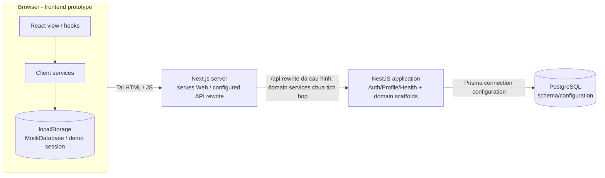
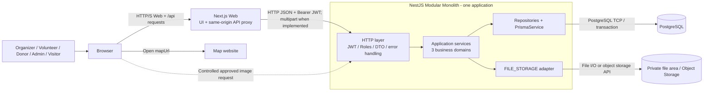

# 03 High-level System Architecture

## Các mức nhìn cần tách

**Hình A** mô tả cấu trúc/prototype đã thấy trong source. **Hình B** mô tả kiến trúc MVP dự kiến theo proposal. Hai hình có thể đặt cạnh nhau; không dùng cùng kiểu nét để diễn đạt mock localStorage và PostgreSQL như cùng một nguồn dữ liệu thực tế.

## Thành phần và công nghệ

| ID  | Component/container                 | Trách nhiệm                                                                                       | Nguồn/trạng thái                                                   |
| --- | ----------------------------------- | ------------------------------------------------------------------------------------------------- | ------------------------------------------------------------------ |
| H01 | Web browser                         | Hiển thị UI, nhận thao tác, gửi request; không quyết định quyền cuối cùng                         | Có frontend client components                                      |
| H02 | OpenAid Web Application             | Next.js/React, Tailwind, route và view; proxy API cùng origin theo rewrite                        | `../OpenAid/package.json`, `next.config.ts`, `src/app`, `src/view` |
| H03 | Mock client services                | auth/event/volunteer/donation/inventory/batch/trip/transparency/admin services gọi storageService | HIỆN CÓ trong FE prototype                                         |
| H04 | Browser localStorage                | MockDatabase và session demo; không phải database kiến trúc MVP                                   | `src/services/storageService.ts`, `src/constants/index.ts` của FE  |
| H05 | OpenAid REST API                    | Một tiến trình NestJS; tất cả domain module trong cùng application                                | HIỆN CÓ/KHUNG, prefix /api                                         |
| H06 | PostgreSQL                          | Nguồn dữ liệu nghiệp vụ bền vững và quan hệ trong MVP                                             | Schema 20 entity; Compose cấu hình Postgres 16                     |
| H07 | File storage adapter                | Interface FileStorage qua FILE_STORAGE; local hoặc cloud khi triển khai                           | Có binding; save/remove vẫn 501                                    |
| H08 | Local directory hoặc Object Storage | Chứa byte ảnh; PostgreSQL giữ metadata/URL                                                        | THIẾT KẾ MVP, chưa có upload volume/provider                       |
| H09 | Map website và QR library           | Mở mapUrl; QR chỉ hỗ trợ attendance nếu làm                                                       | Link/library, không phải GPS service                               |

Framework được khai báo ở hai package hiện tại: FE Next.js 16.4.3 và React 19.3.0; BE NestJS ^12.0.1, Prisma ^6.4.1. Đây là khai báo package tại mốc đối chiếu, không phải khuyến nghị cập nhật version. Bộ kiểm thử repo BE dùng Vitest, dù proposal liệt kê Jest; không đặt Jest như runtime component.

## Hình A cấu trúc hiện tại

Đường nối BE–PG ở đây mô tả cấu hình và cơ chế kết nối; không xác nhận PostgreSQL đang chạy hoặc đã migrate. Đường rewrite cho thấy khả năng đã cấu hình, không chứng minh các client service hiện dùng HTTP.

## Hình B kiến trúc MVP dự kiến

Hình B là thiết kế đích. Đường ảnh minh họa phương án HTTP serving có kiểm soát ở backend; browser không đọc trực tiếp local directory. Nếu chọn private cloud với URL được cấp sau duyệt, có thể vẽ thêm browser → object storage qua HTTPS theo quyết định C03. Nguồn dữ liệu thật là backend/database; localStorage không tiếp tục giữ một bản MockDatabase độc lập làm nguồn nghiệp vụ. Vị trí giữ access token cần chốt C01; hình này chỉ ghi cơ chế Bearer JWT, không tự khẳng định đã dùng cookie HttpOnly.

## Kết nối và nhãn giao thức

| Từ → đến                | Dữ liệu/giao thức                                       | Ghi chú thiết kế                                          |
| ----------------------- | ------------------------------------------------------- | --------------------------------------------------------- |
| Browser → Next.js       | HTTP(S), HTML/JS/CSS và /api                            | Người dùng không nhìn hostname nội bộ Docker              |
| Next.js → NestJS        | HTTP JSON, Authorization: Bearer; ảnh multipart dự kiến | Rewrite hiện dùng BACKEND_API_URL mặc định localhost:3001 |
| NestJS → PostgreSQL     | Prisma qua giao thức PostgreSQL, TCP 5432               | Prisma là thư viện trong backend                          |
| NestJS → Local Storage  | File I/O                                                | Cần directory và persistence nếu chạy container           |
| NestJS → Object Storage | API của provider qua HTTPS                              | Provider chưa chọn; chưa có SDK/cấu hình                  |
| Browser → ảnh công khai | URL được phép sau review                                | URL không được bỏ qua kiểm soát privacy; C03              |
| Browser → Map website   | HTTPS mở mapUrl                                         | Không có định vị nền, ETA hoặc route optimization         |

Trong local development, browser cũng có thể gọi trực tiếp localhost:3001 nếu frontend được cấu hình tương ứng; backend CORS hiện cho origin FRONTEND_URL (mặc định localhost:3000). Phương án tham chiếu ở trên sử dụng rewrite đã có để thống nhất một đường API, không mô tả cả hai như đều đang hoạt động.

## Lớp và trách nhiệm

1. Presentation: page/view/component/hook và thông báo UI.
2. HTTP/API: routing, authentication, system-role guard, validation và response envelope.
3. Application: organization scope, state transition, transaction orchestration và business rules.
4. Data access: truy vấn theo phạm vi, Prisma client/transaction.
5. Persistence: PostgreSQL; byte ảnh tách khỏi bản ghi Evidence.

Nhãn của ba miền chính: Event and Volunteer; Donation and Inventory; Distribution and Transparency. Auth/User/Organization/Admin là nền tảng chung. Dashboard truy vấn, không có service Report độc lập hay kho dữ liệu báo cáo riêng.

## Trust boundaries và các yêu cầu cần gắn vào hình

- Client/browser là đầu vào không tin cậy: backend tự xác định actor từ JWT và kiểm tra trạng thái tài khoản trong database.
- Quyền Organizer dựa vào membership của tổ chức chứa Event; quyền Leader dựa vào assignment của chính Trip.
- Public Tracking chỉ đi qua public projection; không trả raw User/Donation/internal logs.
- Transaction DB bao gồm thay đổi số lượng, trạng thái và audit log; object storage nằm ngoài transaction PostgreSQL.
- NFR01: mục tiêu <3 giây cho API thông thường ở môi trường demo; chưa có benchmark.
- NFR03/05/06: privacy gate, bảo toàn kho và nhật ký là các constraint kiến trúc.
- Không vẽ microservices, message broker, Redis, API Gateway riêng hoặc service discovery: hiện tại không có các thành phần này.
