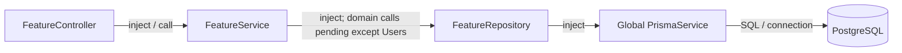
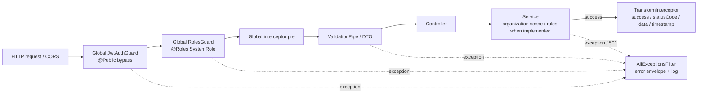
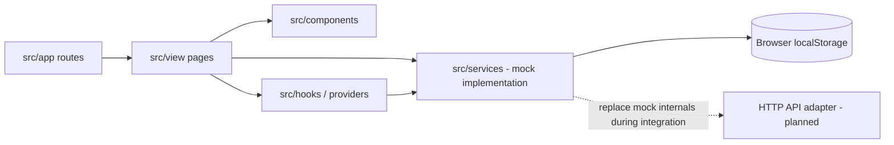

# 04 Module and Component Diagram

## Nguồn và cách đọc

Đối chiếu [AppModule](../../src/app.module.ts), tất cả `src/modules/*/*.module.ts`, constructor của controller/service/repository và [bootstrap](../../src/bootstrap.ts). Danh sách dưới đây là cấu trúc hiện có. Một dependency được inject không đồng nghĩa method đang thực hiện nghiệp vụ; phần lớn service vẫn trả 501.

## Toàn bộ module hiện tại

| Module              | Component chính                                                          | Dữ liệu/trách nhiệm                                       | Dependency đáng chú ý                                                               |
| ------------------- | ------------------------------------------------------------------------ | --------------------------------------------------------- | ----------------------------------------------------------------------------------- |
| AuthModule          | AuthController, AuthService, JwtStrategy, global JwtAuthGuard/RolesGuard | Register/login; JWT; current active user                  | JwtModule, PassportModule, ConfigModule; AuthService/JwtStrategy dùng PrismaService |
| UsersModule         | UsersController, UsersService, UsersRepository                           | Hồ sơ User                                                | Service → repository → PrismaService                                                |
| OrganizationsModule | OrganizationsController/Service/Repository, OrganizationAccessService    | Organization và membership                                | Service → repository; AccessService → PrismaService                                 |
| EventsModule        | EventsController/Service/Repository                                      | Event, VolunteerRole, DonationNeed; catalog ItemType/Unit | Controller/service/repository đã có, nghiệp vụ KHUNG                                |
| VolunteersModule    | VolunteersController/Service/Repository                                  | Application và Attendance                                 | KHUNG                                                                               |
| DonationsModule     | DonationsController/Service/Repository                                   | Donation/Tracking ID/My Donations/receipt                 | KHUNG                                                                               |
| InventoryModule     | InventoryController/Service/Repository                                   | Stock per Event/type/unit                                 | KHUNG; không có API set đè số lượng                                                 |
| BatchesModule       | BatchesController/Service/Repository                                     | Gom nguyên donation, reserve và reconcile                 | KHUNG                                                                               |
| TripsModule         | TripsController/Service/Repository                                       | Trip, TripVolunteer, TripBatch                            | KHUNG                                                                               |
| DistributionModule  | DistributionController/Service/Repository                                | Point status và DistributionRecord                        | KHUNG                                                                               |
| EvidenceModule      | EvidenceController, EvidenceService                                      | Metadata ảnh và review                                    | Imports StorageModule; EvidenceService inject PrismaService và FILE_STORAGE         |
| TransparencyModule  | TransparencyController, TransparencyService, TransparencyRepository      | Public projection, timeline, audit append                 | Service inject PrismaService; repository nhận TransactionClient ở method append     |
| DashboardModule     | DashboardController, DashboardService                                    | Query tổng hợp/báo cáo                                    | Inject PrismaService, KHUNG                                                         |
| AdminModule         | AdminController, AdminService                                            | User/Organization admin; mở rộng moderation theo FR24     | Inject PrismaService; @Roles(ADMIN), KHUNG                                          |
| StorageModule       | StorageService; FILE_STORAGE binding; FileStorage interface              | Cổng lưu/đọc/xóa file                                     | FILE_STORAGE useExisting StorageService; save/remove 501                            |
| HealthModule        | HealthController                                                         | GET /api/health/live                                      | Không có service/repository riêng                                                   |

PrismaModule trong `src/database` và ConfigModule là hạ tầng chung, nằm ngoài 16 module ở `src/modules`. PrismaModule có @Global và export PrismaService. AuthModule đăng ký APP_GUARD cho JWT và Roles; các module không cần import AuthModule lặp lại để được bảo vệ.

## Hình dependency module hiện có

```mermaid
flowchart TB
  APP["AppModule"]
  CFG["ConfigModule - global"]
  PRISMA["PrismaModule - global"]
  AUTH["AuthModule"]
  USERS["UsersModule"]
  ORGS["OrganizationsModule"]
  EVENTS["EventsModule - KHUNG"]
  VOLS["VolunteersModule - KHUNG"]
  DON["DonationsModule - KHUNG"]
  INV["InventoryModule - KHUNG"]
  BATCH["BatchesModule - KHUNG"]
  TRIP["TripsModule - KHUNG"]
  DIST["DistributionModule - KHUNG"]
  EVID["EvidenceModule - KHUNG"]
  TRANS["TransparencyModule - KHUNG"]
  DASH["DashboardModule - KHUNG"]
  ADMIN["AdminModule - KHUNG"]
  HEALTH["HealthModule"]
  STORE["StorageModule - KHUNG"]
  JWT["JwtModule"]
  PASS["PassportModule"]
  APP --> CFG
  APP --> PRISMA
  APP --> AUTH
  APP --> USERS
  APP --> ORGS
  APP --> EVENTS
  APP --> VOLS
  APP --> DON
  APP --> INV
  APP --> BATCH
  APP --> TRIP
  APP --> DIST
  APP --> EVID
  APP --> TRANS
  APP --> DASH
  APP --> ADMIN
  APP --> HEALTH
  EVID -->|"imports"| STORE
  AUTH --> JWT
  AUTH --> PASS
  AUTH --> CFG
```

Không thêm mũi tên EventsModule → OrganizationsModule hay DonationsModule → InventoryModule vào hình “hiện có”: các import phối hợp đó chưa được khai báo.

## Component bên trong backend

Với Users và 8 module organizations/events/volunteers/donations/inventory/batches/trips/distribution, mẫu dependency hiện có là:

Auth, Evidence, Admin, Dashboard và Transparency hiện không tuân cùng một lớp repository trung gian. Vẽ đúng constructor thực tế; không thêm repository giả để hình đối xứng. Riêng TransparencyRepository là provider độc lập có `append(tx, data)`; TransparencyService chưa inject nó và các service nghiệp vụ chưa gọi nó.

Interface/file components cần hiện trong hình chi tiết Evidence: EvidenceController → EvidenceService; EvidenceService → FILE_STORAGE (required interface); StorageService thực hiện FileStorage và được gắn vào token FILE_STORAGE. Nhánh EvidenceService → PrismaService lưu metadata trong tương lai, không có byte ảnh trong PostgreSQL.

## Request pipeline hiện tại

Global RolesGuard chỉ biết USER/ADMIN, chưa thực hiện Organizer/Leader authorization. OrganizationAccessService là helper đã có; việc gọi helper trong từng workflow vẫn chờ triển khai.

## Phối hợp nghiệp vụ đích

Các mũi tên sau là **THIẾT KẾ MVP**, không phải module import đã có.

| Use case owner             | Thành phần cần phối hợp                                        | Dữ liệu phải cùng transaction                                       |
| -------------------------- | -------------------------------------------------------------- | ------------------------------------------------------------------- |
| OrganizationsService       | membership writer, audit append                                | Organization PENDING + OrganizationMember ORGANIZER + log           |
| EventsService              | OrganizationAccessService, event data, audit append            | Event/roles/needs hoặc status + log                                 |
| VolunteersService          | event/application query, OrganizationAccessService, audit      | Application/Attendance + log                                        |
| DonationsService.receipt   | scope check, donation writer, stock operations, audit          | Donation RECEIVED + Inventory Received/Available + log              |
| BatchesService.createBatch | eligible donations, inventory operations, audit                | Batch + Donation.batchId/status + Available/Reserved + log          |
| TripsService.createTrip    | scope check, applications/batches validation, audit            | Trip + assignments + Points + batch status + log                    |
| TripsService.cancel        | Point/record aggregate query, assignments, batch status, audit | Trip CANCELLED + unassignedAt + Batch READY + logs; stock unchanged |
| DistributionService        | scope/Leader check, TripBatch/Point, stock operations, audit   | Record + Reserved/Distributed + required statuses/log               |
| EvidenceService            | scope checks, FileStorage, metadata writer, audit              | Metadata/review/log in DB; file store compensated separately        |
| TransparencyService        | read projection, membership scope for internal views           | Read/query, no mutation or authenticity validation                  |
| DashboardService           | scoped aggregate queries                                       | Needed/Pledged/Received/Distributed by Event/type/unit              |

Hợp đồng stock operation có thể nhận Prisma.TransactionClient từ use case owner để tránh mỗi service tự commit riêng. Đây là hướng phối hợp, tên method stock cụ thể chưa có trong code. Kiểm tra concurrency bằng conditional update/locking phù hợp khi triển khai.

Để tránh dependency cycle, TripsService có thể đọc aggregate Point/Record qua repository của aggregate Trip khi kiểm tra complete/cancel; không bắt buộc TripsModule import DistributionModule trong khi DistributionModule lại import TripsModule. Không export toàn bộ repository để tạo truy cập chéo tùy ý.

## Frontend component view

Cấu trúc đã thấy: App Router trong `src/app` re-export page của `src/view`; view dùng components, hooks/providers và client services. `useAuth` dùng authService/storageService; các service prototype đọc ghi localStorage.

Các vùng UI đã có tên route: login/register/profile, events, volunteer/apply, donate, my/activities, my/donations, track, organizer/events/volunteers/donations/inventory/batches/trips/transparency/dashboard, admin/users/organizations/events/dashboard. Không suy từ sự tồn tại page rằng API tương ứng đã tích hợp.
