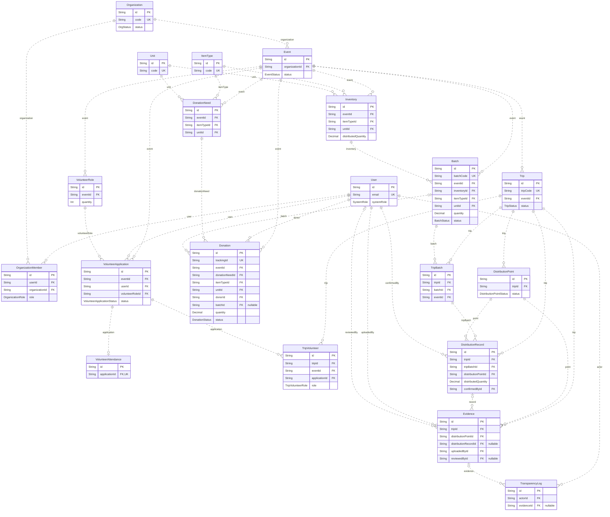

# 05 Data Model and ERD

Nguồn: [schema.prisma](../../prisma/schema.prisma) và [initial migration SQL](../../prisma/migrations/20261028000000_init/migration.sql). Danh mục được đối chiếu Prisma metadata với schema ở mốc 28/10/2026; không khẳng định database đã migrate.

## Tổng quan

Có 20 entity và 12 enum. Inventory tương ứng InventoryItem, Batch tương ứng DonationBatch, Trip tương ứng DistributionTrip trong proposal. Không có BatchItem riêng: Donation.batchId nullable biểu diễn whole-donation membership. Không có Report, Notification hay IssueReport entity.

| Entity               | Bảng vật lý            | Ý nghĩa                                                             |
| -------------------- | ---------------------- | ------------------------------------------------------------------- |
| User                 | users                  | Tài khoản, systemRole và active; passwordHash không được công khai. |
| Organization         | organizations          | Tổ chức cứu trợ và trạng thái hoạt động.                            |
| OrganizationMember   | organization_members   | Membership theo tổ chức, role MEMBER/ORGANIZER.                     |
| Event                | events                 | Trung tâm chiến dịch, thuộc một Organization.                       |
| VolunteerRole        | volunteer_roles        | Nhu cầu vai trò và số lượng người trong Event.                      |
| VolunteerApplication | volunteer_applications | Một người chọn một vai trò cho một Event.                           |
| VolunteerAttendance  | volunteer_attendance   | Check-in/check-out tách khỏi Application status.                    |
| ItemType             | item_types             | Danh mục loại hàng chuẩn.                                           |
| Unit                 | units                  | Danh mục đơn vị đo chuẩn.                                           |
| DonationNeed         | donation_needs         | Target hiện vật cho Event, loại hàng và đơn vị.                     |
| Donation             | donations              | Cam kết của donor, Tracking ID, tối đa một Batch.                   |
| Inventory            | inventories            | Stock của một Event/type/unit; suy Organization qua Event.          |
| Batch                | batches                | Lô gồm nguyên các Donation cùng Event/type/unit.                    |
| Trip                 | trips                  | Chuyến đi của một Event.                                            |
| TripVolunteer        | trip_volunteers        | Application được gán vào Trip; LEADER/MEMBER.                       |
| TripBatch            | trip_batches           | Lịch sử gán Batch vào Trip; active khi unassignedAt NULL.           |
| DistributionPoint    | distribution_points    | Điểm phát có thứ tự và trạng thái riêng.                            |
| DistributionRecord   | distribution_records   | Số lượng một TripBatch tại một Point.                               |
| Evidence             | evidence               | Metadata ảnh, uploader, privacy và Organizer review.                |
| TransparencyLog      | transparency_logs      | Actor, time, old/new status, evidence và logical entity reference.  |

## ERD tổng quan

Các đường là FK thực. Mỗi bảng có PK id riêng nên dùng nét đứt cho quan hệ non-identifying; trong ERD, kiểu nét này không mang nghĩa chưa triển khai. Đầu parent có 0..1 nếu relation nullable; đầu child có 0..n, riêng Attendance là 0..1. Các trường hiển thị chọn lọc; từ điển đầy đủ nằm bên dưới.

## Toàn bộ khóa ngoại và cardinality

| Quan hệ ở child                    | FK tại child                                      | Parent và khóa tham chiếu                            | Parent trên mỗi child | Child trên mỗi parent |
| ---------------------------------- | ------------------------------------------------- | ---------------------------------------------------- | --------------------- | --------------------- |
| OrganizationMember.user            | userId                                            | User (id)                                            | 1                     | 0..n                  |
| OrganizationMember.organization    | organizationId                                    | Organization (id)                                    | 1                     | 0..n                  |
| Event.organization                 | organizationId                                    | Organization (id)                                    | 1                     | 0..n                  |
| VolunteerRole.event                | eventId                                           | Event (id)                                           | 1                     | 0..n                  |
| VolunteerApplication.event         | eventId                                           | Event (id)                                           | 1                     | 0..n                  |
| VolunteerApplication.user          | userId                                            | User (id)                                            | 1                     | 0..n                  |
| VolunteerApplication.volunteerRole | volunteerRoleId, eventId                          | VolunteerRole (id, eventId)                          | 1                     | 0..n                  |
| VolunteerAttendance.application    | applicationId                                     | VolunteerApplication (id)                            | 1                     | 0..1                  |
| DonationNeed.event                 | eventId                                           | Event (id)                                           | 1                     | 0..n                  |
| DonationNeed.itemType              | itemTypeId                                        | ItemType (id)                                        | 1                     | 0..n                  |
| DonationNeed.unit                  | unitId                                            | Unit (id)                                            | 1                     | 0..n                  |
| Donation.event                     | eventId                                           | Event (id)                                           | 1                     | 0..n                  |
| Donation.donor                     | donorId                                           | User (id)                                            | 1                     | 0..n                  |
| Donation.donationNeed              | donationNeedId, eventId, itemTypeId, unitId       | DonationNeed (id, eventId, itemTypeId, unitId)       | 1                     | 0..n                  |
| Donation.batch                     | batchId, eventId, itemTypeId, unitId              | Batch (id, eventId, itemTypeId, unitId)              | 0..1                  | 0..n                  |
| Inventory.event                    | eventId                                           | Event (id)                                           | 1                     | 0..n                  |
| Inventory.itemType                 | itemTypeId                                        | ItemType (id)                                        | 1                     | 0..n                  |
| Inventory.unit                     | unitId                                            | Unit (id)                                            | 1                     | 0..n                  |
| Batch.event                        | eventId                                           | Event (id)                                           | 1                     | 0..n                  |
| Batch.inventory                    | inventoryId, eventId, itemTypeId, unitId          | Inventory (id, eventId, itemTypeId, unitId)          | 1                     | 0..n                  |
| Trip.event                         | eventId                                           | Event (id)                                           | 1                     | 0..n                  |
| TripVolunteer.trip                 | tripId, eventId                                   | Trip (id, eventId)                                   | 1                     | 0..n                  |
| TripVolunteer.application          | applicationId, eventId                            | VolunteerApplication (id, eventId)                   | 1                     | 0..n                  |
| TripBatch.trip                     | tripId, eventId                                   | Trip (id, eventId)                                   | 1                     | 0..n                  |
| TripBatch.batch                    | batchId, eventId                                  | Batch (id, eventId)                                  | 1                     | 0..n                  |
| DistributionPoint.trip             | tripId                                            | Trip (id)                                            | 1                     | 0..n                  |
| DistributionRecord.trip            | tripId                                            | Trip (id)                                            | 1                     | 0..n                  |
| DistributionRecord.tripBatch       | tripBatchId, tripId                               | TripBatch (id, tripId)                               | 1                     | 0..n                  |
| DistributionRecord.point           | distributionPointId, tripId                       | DistributionPoint (id, tripId)                       | 1                     | 0..n                  |
| DistributionRecord.confirmedBy     | confirmedById                                     | User (id)                                            | 1                     | 0..n                  |
| Evidence.trip                      | tripId                                            | Trip (id)                                            | 1                     | 0..n                  |
| Evidence.point                     | distributionPointId, tripId                       | DistributionPoint (id, tripId)                       | 1                     | 0..n                  |
| Evidence.record                    | distributionRecordId, tripId, distributionPointId | DistributionRecord (id, tripId, distributionPointId) | 0..1                  | 0..n                  |
| Evidence.uploadedBy                | uploadedById                                      | User (id)                                            | 1                     | 0..n                  |
| Evidence.reviewedBy                | reviewedById                                      | User (id)                                            | 0..1                  | 0..n                  |
| TransparencyLog.actor              | actorId                                           | User (id)                                            | 1                     | 0..n                  |
| TransparencyLog.evidence           | evidenceId                                        | Evidence (id)                                        | 0..1                  | 0..n                  |

Mọi FK dùng onDelete Restrict; SQL dùng ON UPDATE CASCADE. Cùng một cột có thể thuộc nhiều FK ghép, không tạo thêm cột lặp. TransparencyLog.entityType/entityId là tham chiếu logic đa hình, không có FK SQL tới mọi entity; actorId và evidenceId mới là FK thật. Donation.itemTypeId/unitId bị khóa qua DonationNeed/Batch, không có relation trực tiếp riêng tới ItemType/Unit. TripVolunteer.eventId và TripBatch.eventId cũng được khóa qua FK ghép, không có thêm FK riêng tới Event.

## Từ điển toàn bộ trường

String id dùng uuid() ở Prisma nhưng cột PostgreSQL hiện là TEXT, không phải native UUID. Dấu ? là nullable. uuid() và @updatedAt do Prisma quản lý, không tự diễn giải thành SQL default. Decimal là DECIMAL(14,3); các relation object/list không tạo cột SQL riêng.

### User — users

Tài khoản, systemRole và active; passwordHash không được công khai.

| Trường       | Prisma type | PostgreSQL type | Nullable | Khóa | Default/cơ chế |
| ------------ | ----------- | --------------- | -------- | ---- | -------------- |
| id           | String      | TEXT            | Không    | PK   | uuid()         |
| email        | String      | TEXT            | Không    | UK   | —              |
| passwordHash | String      | TEXT            | Không    | —    | —              |
| fullName     | String      | TEXT            | Không    | —    | —              |
| phoneNumber  | String?     | TEXT            | Có       | —    | —              |
| avatarUrl    | String?     | TEXT            | Có       | —    | —              |
| systemRole   | SystemRole  | SystemRole      | Không    | —    | USER           |
| isActive     | Boolean     | BOOLEAN         | Không    | —    | true           |
| createdAt    | DateTime    | TIMESTAMP(3)    | Không    | —    | now()          |
| updatedAt    | DateTime    | TIMESTAMP(3)    | Không    | —    | @updatedAt     |

### Organization — organizations

Tổ chức cứu trợ và trạng thái hoạt động.

| Trường      | Prisma type | PostgreSQL type | Nullable | Khóa | Default/cơ chế |
| ----------- | ----------- | --------------- | -------- | ---- | -------------- |
| id          | String      | TEXT            | Không    | PK   | uuid()         |
| name        | String      | TEXT            | Không    | —    | —              |
| code        | String      | TEXT            | Không    | UK   | —              |
| description | String?     | TEXT            | Có       | —    | —              |
| email       | String      | TEXT            | Không    | —    | —              |
| phoneNumber | String?     | TEXT            | Có       | —    | —              |
| address     | String?     | TEXT            | Có       | —    | —              |
| status      | OrgStatus   | OrgStatus       | Không    | —    | PENDING        |
| createdAt   | DateTime    | TIMESTAMP(3)    | Không    | —    | now()          |
| updatedAt   | DateTime    | TIMESTAMP(3)    | Không    | —    | @updatedAt     |

### OrganizationMember — organization_members

Membership theo tổ chức, role MEMBER/ORGANIZER.

| Trường         | Prisma type      | PostgreSQL type  | Nullable | Khóa | Default/cơ chế |
| -------------- | ---------------- | ---------------- | -------- | ---- | -------------- |
| id             | String           | TEXT             | Không    | PK   | uuid()         |
| userId         | String           | TEXT             | Không    | FK   | —              |
| organizationId | String           | TEXT             | Không    | FK   | —              |
| role           | OrganizationRole | OrganizationRole | Không    | —    | MEMBER         |
| createdAt      | DateTime         | TIMESTAMP(3)     | Không    | —    | now()          |

Unique ghép: (userId, organizationId).

Index: @@index([organizationId, role]).

### Event — events

Trung tâm chiến dịch, thuộc một Organization.

| Trường         | Prisma type | PostgreSQL type | Nullable | Khóa | Default/cơ chế |
| -------------- | ----------- | --------------- | -------- | ---- | -------------- |
| id             | String      | TEXT            | Không    | PK   | uuid()         |
| organizationId | String      | TEXT            | Không    | FK   | —              |
| title          | String      | TEXT            | Không    | —    | —              |
| description    | String?     | TEXT            | Có       | —    | —              |
| location       | String      | TEXT            | Không    | —    | —              |
| contactName    | String      | TEXT            | Không    | —    | —              |
| contactPhone   | String?     | TEXT            | Có       | —    | —              |
| startDate      | DateTime    | TIMESTAMP(3)    | Không    | —    | —              |
| endDate        | DateTime?   | TIMESTAMP(3)    | Có       | —    | —              |
| status         | EventStatus | EventStatus     | Không    | —    | DRAFT          |
| createdAt      | DateTime    | TIMESTAMP(3)    | Không    | —    | now()          |
| updatedAt      | DateTime    | TIMESTAMP(3)    | Không    | —    | @updatedAt     |

Index: @@index([organizationId, status]); @@index([status, startDate]).

### VolunteerRole — volunteer_roles

Nhu cầu vai trò và số lượng người trong Event.

| Trường      | Prisma type | PostgreSQL type | Nullable | Khóa | Default/cơ chế |
| ----------- | ----------- | --------------- | -------- | ---- | -------------- |
| id          | String      | TEXT            | Không    | PK   | uuid()         |
| eventId     | String      | TEXT            | Không    | FK   | —              |
| name        | String      | TEXT            | Không    | —    | —              |
| description | String?     | TEXT            | Có       | —    | —              |
| quantity    | Int         | INTEGER         | Không    | —    | —              |
| createdAt   | DateTime    | TIMESTAMP(3)    | Không    | —    | now()          |
| updatedAt   | DateTime    | TIMESTAMP(3)    | Không    | —    | @updatedAt     |

Unique ghép: (id, eventId); (eventId, name).

### VolunteerApplication — volunteer_applications

Một người chọn một vai trò cho một Event.

| Trường          | Prisma type                | PostgreSQL type            | Nullable | Khóa | Default/cơ chế |
| --------------- | -------------------------- | -------------------------- | -------- | ---- | -------------- |
| id              | String                     | TEXT                       | Không    | PK   | uuid()         |
| eventId         | String                     | TEXT                       | Không    | FK   | —              |
| userId          | String                     | TEXT                       | Không    | FK   | —              |
| volunteerRoleId | String                     | TEXT                       | Không    | FK   | —              |
| status          | VolunteerApplicationStatus | VolunteerApplicationStatus | Không    | —    | PENDING        |
| notes           | String?                    | TEXT                       | Có       | —    | —              |
| createdAt       | DateTime                   | TIMESTAMP(3)               | Không    | —    | now()          |
| updatedAt       | DateTime                   | TIMESTAMP(3)               | Không    | —    | @updatedAt     |

Unique ghép: (eventId, userId); (id, eventId).

Index: @@index([userId, status]).

### VolunteerAttendance — volunteer_attendance

Check-in/check-out tách khỏi Application status.

| Trường        | Prisma type | PostgreSQL type | Nullable | Khóa   | Default/cơ chế |
| ------------- | ----------- | --------------- | -------- | ------ | -------------- |
| id            | String      | TEXT            | Không    | PK     | uuid()         |
| applicationId | String      | TEXT            | Không    | FK, UK | —              |
| checkedInAt   | DateTime    | TIMESTAMP(3)    | Không    | —      | —              |
| checkedOutAt  | DateTime?   | TIMESTAMP(3)    | Có       | —      | —              |

### ItemType — item_types

Danh mục loại hàng chuẩn.

| Trường   | Prisma type | PostgreSQL type | Nullable | Khóa | Default/cơ chế |
| -------- | ----------- | --------------- | -------- | ---- | -------------- |
| id       | String      | TEXT            | Không    | PK   | uuid()         |
| code     | String      | TEXT            | Không    | UK   | —              |
| name     | String      | TEXT            | Không    | —    | —              |
| category | String      | TEXT            | Không    | —    | —              |

### Unit — units

Danh mục đơn vị đo chuẩn.

| Trường | Prisma type | PostgreSQL type | Nullable | Khóa | Default/cơ chế |
| ------ | ----------- | --------------- | -------- | ---- | -------------- |
| id     | String      | TEXT            | Không    | PK   | uuid()         |
| code   | String      | TEXT            | Không    | UK   | —              |
| name   | String      | TEXT            | Không    | —    | —              |

### DonationNeed — donation_needs

Target hiện vật cho Event, loại hàng và đơn vị.

| Trường         | Prisma type | PostgreSQL type | Nullable | Khóa | Default/cơ chế |
| -------------- | ----------- | --------------- | -------- | ---- | -------------- |
| id             | String      | TEXT            | Không    | PK   | uuid()         |
| eventId        | String      | TEXT            | Không    | FK   | —              |
| itemTypeId     | String      | TEXT            | Không    | FK   | —              |
| unitId         | String      | TEXT            | Không    | FK   | —              |
| targetQuantity | Decimal     | Decimal(14,3)   | Không    | —    | —              |
| notes          | String?     | TEXT            | Có       | —    | —              |

Unique ghép: (eventId, itemTypeId, unitId); (id, eventId, itemTypeId, unitId).

### Donation — donations

Cam kết của donor, Tracking ID, tối đa một Batch.

| Trường          | Prisma type    | PostgreSQL type | Nullable | Khóa | Default/cơ chế |
| --------------- | -------------- | --------------- | -------- | ---- | -------------- |
| id              | String         | TEXT            | Không    | PK   | uuid()         |
| trackingId      | String         | TEXT            | Không    | UK   | —              |
| eventId         | String         | TEXT            | Không    | FK   | —              |
| donationNeedId  | String         | TEXT            | Không    | FK   | —              |
| itemTypeId      | String         | TEXT            | Không    | FK   | —              |
| unitId          | String         | TEXT            | Không    | FK   | —              |
| donorId         | String         | TEXT            | Không    | FK   | —              |
| batchId         | String?        | TEXT            | Có       | FK   | —              |
| quantity        | Decimal        | Decimal(14,3)   | Không    | —    | —              |
| photoUrl        | String?        | TEXT            | Có       | —    | —              |
| status          | DonationStatus | DonationStatus  | Không    | —    | PENDING        |
| receivedAt      | DateTime?      | TIMESTAMP(3)    | Có       | —    | —              |
| rejectionReason | String?        | TEXT            | Có       | —    | —              |
| createdAt       | DateTime       | TIMESTAMP(3)    | Không    | —    | now()          |
| updatedAt       | DateTime       | TIMESTAMP(3)    | Không    | —    | @updatedAt     |

Index: @@index([donorId, createdAt]); @@index([eventId, status]); @@index([batchId]).

### Inventory — inventories

Stock của một Event/type/unit; suy Organization qua Event.

| Trường              | Prisma type | PostgreSQL type | Nullable | Khóa | Default/cơ chế |
| ------------------- | ----------- | --------------- | -------- | ---- | -------------- |
| id                  | String      | TEXT            | Không    | PK   | uuid()         |
| eventId             | String      | TEXT            | Không    | FK   | —              |
| itemTypeId          | String      | TEXT            | Không    | FK   | —              |
| unitId              | String      | TEXT            | Không    | FK   | —              |
| receivedQuantity    | Decimal     | Decimal(14,3)   | Không    | —    | 0              |
| availableQuantity   | Decimal     | Decimal(14,3)   | Không    | —    | 0              |
| reservedQuantity    | Decimal     | Decimal(14,3)   | Không    | —    | 0              |
| distributedQuantity | Decimal     | Decimal(14,3)   | Không    | —    | 0              |
| lostQuantity        | Decimal     | Decimal(14,3)   | Không    | —    | 0              |
| updatedAt           | DateTime    | TIMESTAMP(3)    | Không    | —    | @updatedAt     |

Unique ghép: (eventId, itemTypeId, unitId); (id, eventId, itemTypeId, unitId).

### Batch — batches

Lô gồm nguyên các Donation cùng Event/type/unit.

| Trường             | Prisma type | PostgreSQL type | Nullable | Khóa | Default/cơ chế |
| ------------------ | ----------- | --------------- | -------- | ---- | -------------- |
| id                 | String      | TEXT            | Không    | PK   | uuid()         |
| batchCode          | String      | TEXT            | Không    | UK   | —              |
| eventId            | String      | TEXT            | Không    | FK   | —              |
| inventoryId        | String      | TEXT            | Không    | FK   | —              |
| itemTypeId         | String      | TEXT            | Không    | FK   | —              |
| unitId             | String      | TEXT            | Không    | FK   | —              |
| quantity           | Decimal     | Decimal(14,3)   | Không    | —    | —              |
| returnedQuantity   | Decimal     | Decimal(14,3)   | Không    | —    | 0              |
| lostQuantity       | Decimal     | Decimal(14,3)   | Không    | —    | 0              |
| reconciliationNote | String?     | TEXT            | Có       | —    | —              |
| status             | BatchStatus | BatchStatus     | Không    | —    | DRAFT          |
| createdAt          | DateTime    | TIMESTAMP(3)    | Không    | —    | now()          |
| updatedAt          | DateTime    | TIMESTAMP(3)    | Không    | —    | @updatedAt     |

Unique ghép: (id, eventId); (id, eventId, itemTypeId, unitId).

Index: @@index([eventId, status]).

### Trip — trips

Chuyến đi của một Event.

| Trường         | Prisma type | PostgreSQL type | Nullable | Khóa | Default/cơ chế |
| -------------- | ----------- | --------------- | -------- | ---- | -------------- |
| id             | String      | TEXT            | Không    | PK   | uuid()         |
| tripCode       | String      | TEXT            | Không    | UK   | —              |
| eventId        | String      | TEXT            | Không    | FK   | —              |
| departurePoint | String      | TEXT            | Không    | —    | —              |
| departureDate  | DateTime    | TIMESTAMP(3)    | Không    | —    | —              |
| vehicle        | String?     | TEXT            | Có       | —    | —              |
| status         | TripStatus  | TripStatus      | Không    | —    | SCHEDULED      |
| completedAt    | DateTime?   | TIMESTAMP(3)    | Có       | —    | —              |
| createdAt      | DateTime    | TIMESTAMP(3)    | Không    | —    | now()          |
| updatedAt      | DateTime    | TIMESTAMP(3)    | Không    | —    | @updatedAt     |

Unique ghép: (id, eventId).

Index: @@index([eventId, status]).

### TripVolunteer — trip_volunteers

Application được gán vào Trip; LEADER/MEMBER.

| Trường        | Prisma type       | PostgreSQL type   | Nullable | Khóa | Default/cơ chế |
| ------------- | ----------------- | ----------------- | -------- | ---- | -------------- |
| id            | String            | TEXT              | Không    | PK   | uuid()         |
| tripId        | String            | TEXT              | Không    | FK   | —              |
| eventId       | String            | TEXT              | Không    | FK   | —              |
| applicationId | String            | TEXT              | Không    | FK   | —              |
| role          | TripVolunteerRole | TripVolunteerRole | Không    | —    | MEMBER         |
| assignedAt    | DateTime          | TIMESTAMP(3)      | Không    | —    | now()          |

Unique ghép: (tripId, applicationId).

### TripBatch — trip_batches

Lịch sử gán Batch vào Trip; active khi unassignedAt NULL.

| Trường       | Prisma type | PostgreSQL type | Nullable | Khóa | Default/cơ chế |
| ------------ | ----------- | --------------- | -------- | ---- | -------------- |
| id           | String      | TEXT            | Không    | PK   | uuid()         |
| tripId       | String      | TEXT            | Không    | FK   | —              |
| batchId      | String      | TEXT            | Không    | FK   | —              |
| eventId      | String      | TEXT            | Không    | FK   | —              |
| assignedAt   | DateTime    | TIMESTAMP(3)    | Không    | —    | now()          |
| unassignedAt | DateTime?   | TIMESTAMP(3)    | Có       | —    | —              |

Unique ghép: (tripId, batchId); (id, tripId).

### DistributionPoint — distribution_points

Điểm phát có thứ tự và trạng thái riêng.

| Trường        | Prisma type             | PostgreSQL type         | Nullable | Khóa | Default/cơ chế |
| ------------- | ----------------------- | ----------------------- | -------- | ---- | -------------- |
| id            | String                  | TEXT                    | Không    | PK   | uuid()         |
| tripId        | String                  | TEXT                    | Không    | FK   | —              |
| position      | Int                     | INTEGER                 | Không    | —    | —              |
| name          | String                  | TEXT                    | Không    | —    | —              |
| location      | String                  | TEXT                    | Không    | —    | —              |
| mapUrl        | String?                 | TEXT                    | Có       | —    | —              |
| status        | DistributionPointStatus | DistributionPointStatus | Không    | —    | PENDING        |
| arrivedAt     | DateTime?               | TIMESTAMP(3)            | Có       | —    | —              |
| distributedAt | DateTime?               | TIMESTAMP(3)            | Có       | —    | —              |
| skippedReason | String?                 | TEXT                    | Có       | —    | —              |

Unique ghép: (tripId, position); (id, tripId).

### DistributionRecord — distribution_records

Số lượng một TripBatch tại một Point.

| Trường              | Prisma type | PostgreSQL type | Nullable | Khóa | Default/cơ chế |
| ------------------- | ----------- | --------------- | -------- | ---- | -------------- |
| id                  | String      | TEXT            | Không    | PK   | uuid()         |
| tripId              | String      | TEXT            | Không    | FK   | —              |
| tripBatchId         | String      | TEXT            | Không    | FK   | —              |
| distributionPointId | String      | TEXT            | Không    | FK   | —              |
| distributedQuantity | Decimal     | Decimal(14,3)   | Không    | —    | —              |
| beneficiaryCount    | Int         | INTEGER         | Không    | —    | 0              |
| notes               | String?     | TEXT            | Có       | —    | —              |
| confirmedById       | String      | TEXT            | Không    | FK   | —              |
| confirmedAt         | DateTime    | TIMESTAMP(3)    | Không    | —    | now()          |

Unique ghép: (tripBatchId, distributionPointId); (id, tripId, distributionPointId).

### Evidence — evidence

Metadata ảnh, uploader, privacy và Organizer review.

| Trường               | Prisma type          | PostgreSQL type      | Nullable | Khóa | Default/cơ chế |
| -------------------- | -------------------- | -------------------- | -------- | ---- | -------------- |
| id                   | String               | TEXT                 | Không    | PK   | uuid()         |
| tripId               | String               | TEXT                 | Không    | FK   | —              |
| distributionPointId  | String               | TEXT                 | Không    | FK   | —              |
| distributionRecordId | String?              | TEXT                 | Có       | FK   | —              |
| uploadedById         | String               | TEXT                 | Không    | FK   | —              |
| imageUrl             | String               | TEXT                 | Không    | —    | —              |
| mimeType             | String               | TEXT                 | Không    | —    | —              |
| sizeBytes            | Int                  | INTEGER              | Không    | —    | —              |
| caption              | String?              | TEXT                 | Có       | —    | —              |
| privacyConfirmed     | Boolean              | BOOLEAN              | Không    | —    | false          |
| reviewStatus         | EvidenceReviewStatus | EvidenceReviewStatus | Không    | —    | PENDING        |
| reviewedById         | String?              | TEXT                 | Có       | FK   | —              |
| reviewedAt           | DateTime?            | TIMESTAMP(3)         | Có       | —    | —              |
| reviewNote           | String?              | TEXT                 | Có       | —    | —              |
| uploadedAt           | DateTime             | TIMESTAMP(3)         | Không    | —    | now()          |

Index: @@index([tripId, reviewStatus]).

### TransparencyLog — transparency_logs

Actor, time, old/new status, evidence và logical entity reference.

| Trường     | Prisma type            | PostgreSQL type        | Nullable | Khóa | Default/cơ chế |
| ---------- | ---------------------- | ---------------------- | -------- | ---- | -------------- |
| id         | String                 | TEXT                   | Không    | PK   | uuid()         |
| action     | String                 | TEXT                   | Không    | —    | —              |
| entityType | TransparencyEntityType | TransparencyEntityType | Không    | —    | —              |
| entityId   | String                 | TEXT                   | Không    | —    | —              |
| actorId    | String                 | TEXT                   | Không    | FK   | —              |
| oldStatus  | String?                | TEXT                   | Có       | —    | —              |
| newStatus  | String?                | TEXT                   | Có       | —    | —              |
| evidenceId | String?                | TEXT                   | Có       | FK   | —              |
| details    | Json?                  | JSONB                  | Có       | —    | —              |
| createdAt  | DateTime               | TIMESTAMP(3)           | Không    | —    | now()          |

Index: @@index([entityType, entityId, createdAt]).

## Toàn bộ enum

| Enum                       | Giá trị chính xác                                                                                                               |
| -------------------------- | ------------------------------------------------------------------------------------------------------------------------------- |
| SystemRole                 | USER, ADMIN                                                                                                                     |
| OrganizationRole           | MEMBER, ORGANIZER                                                                                                               |
| OrgStatus                  | PENDING, APPROVED, REJECTED, SUSPENDED                                                                                          |
| EventStatus                | DRAFT, PUBLISHED, CLOSED, CANCELLED                                                                                             |
| VolunteerApplicationStatus | PENDING, APPROVED, REJECTED                                                                                                     |
| DonationStatus             | PENDING, RECEIVED, REJECTED, IN_BATCH, DISTRIBUTED, CANCELLED                                                                   |
| BatchStatus                | DRAFT, READY, ASSIGNED, DISTRIBUTED                                                                                             |
| TripStatus                 | SCHEDULED, PREPARING, IN_TRANSIT, COMPLETED, CANCELLED                                                                          |
| TripVolunteerRole          | LEADER, MEMBER                                                                                                                  |
| DistributionPointStatus    | PENDING, ARRIVED, DISTRIBUTED, SKIPPED                                                                                          |
| EvidenceReviewStatus       | PENDING, APPROVED, REJECTED                                                                                                     |
| TransparencyEntityType     | ORGANIZATION, EVENT, VOLUNTEER_APPLICATION, DONATION, INVENTORY, BATCH, TRIP, DISTRIBUTION_POINT, DISTRIBUTION_RECORD, EVIDENCE |

Enum không tự kiểm tra transition; xem phần 06.

## Constraint chỉ có trong SQL migration

| Tên                                   | Điều kiện                                                           |
| ------------------------------------- | ------------------------------------------------------------------- |
| events_dates_check                    | endDate NULL hoặc >= startDate                                      |
| volunteer_roles_quantity_check        | quantity >0                                                         |
| attendance_dates_check                | checkedOutAt NULL hoặc >= checkedInAt                               |
| donation_needs_quantity_check         | targetQuantity >0                                                   |
| donations_quantity_check              | quantity >0                                                         |
| inventories_quantities_check          | Các lượng >=0; Received = Available + Reserved + Distributed + Lost |
| batches_quantities_check              | quantity >0; returned/lost >=0; returned + lost <= quantity         |
| batches_reconciliation_note_check     | Returned/lost >0 phải có reconciliationNote không rỗng              |
| trip_batches_dates_check              | unassignedAt NULL hoặc >= assignedAt                                |
| trip_batches_one_active_assignment    | UNIQUE batchId WHERE unassignedAt IS NULL                           |
| trip_volunteers_one_leader            | UNIQUE tripId WHERE role = LEADER                                   |
| distribution_points_position_check    | position >0; schema có unique(tripId, position)                     |
| distribution_records_quantities_check | distributedQuantity >0; beneficiaryCount >=0                        |
| evidence_upload_check                 | 0 < sizeBytes <= 5242880, MIME JPEG/PNG/WebP                        |
| evidence_public_review_check          | APPROVED cần privacyConfirmed=true, reviewer và reviewedAt          |

Partial index chỉ bảo đảm tối đa một Leader, không phải phải có đúng một. FK không kiểm tra Application APPROVED. Tổng các DistributionRecord không vượt Batch.quantity, quyền actor, Event public, state transition và chất lượng ảnh cần service/transaction. Các array bắt buộc không rỗng ở DTO tạo Trip không phải cardinality tối thiểu được FK bảo đảm.

Một Batch có 0..n TripBatch theo lịch sử nhưng tối đa một active assignment. unique(tripId,batchId) ngăn một Batch lặp trong cùng Trip. Remaining được tính từ quantity trừ Records/returned/lost, không có cột riêng.

## Cách chia ERD

1. Identity/Event/Volunteer: User, Organization, OrganizationMember, Event, VolunteerRole, VolunteerApplication, VolunteerAttendance, TripVolunteer.
2. Donation/Inventory/Batch: Event, ItemType, Unit, DonationNeed, Donation, Inventory, Batch.
3. Distribution/Evidence/Audit: Event, User, Batch, Trip, TripVolunteer, TripBatch, DistributionPoint, DistributionRecord, Evidence, TransparencyLog.

Entity xuất hiện ở nhiều hình là cùng một bảng. Gắn nhãn uploader/reviewer/actor riêng để phân biệt các quan hệ với User. [Ký hiệu Mermaid ER](https://mermaid.js.org/syntax/entityRelationshipDiagram.html).
