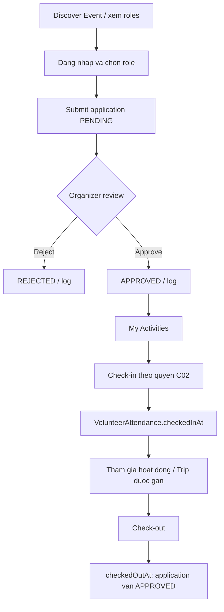
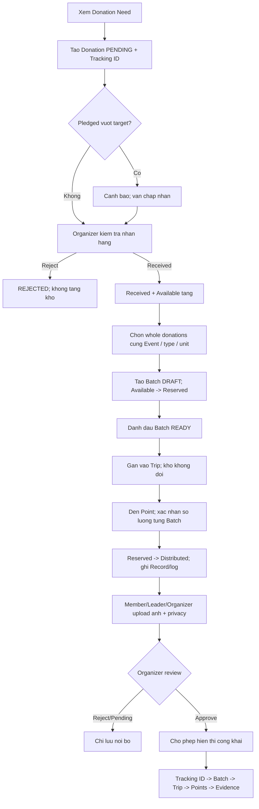
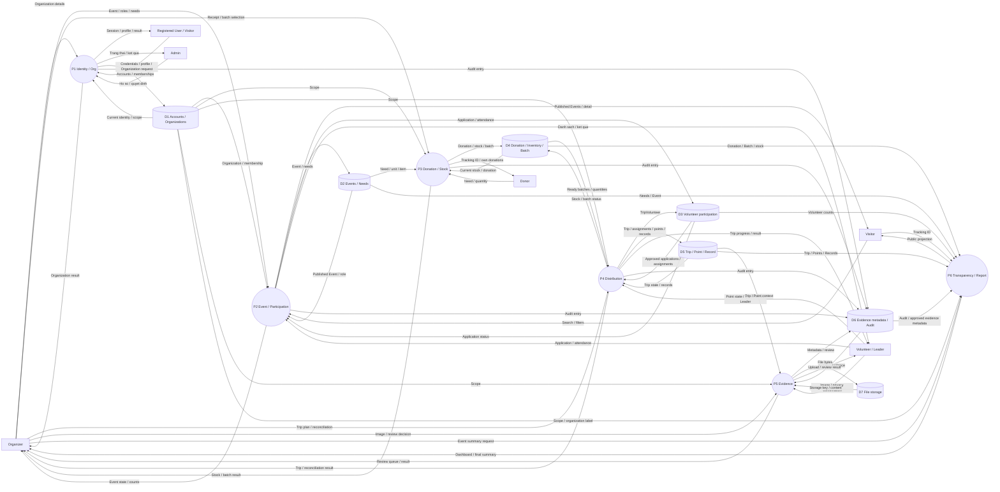
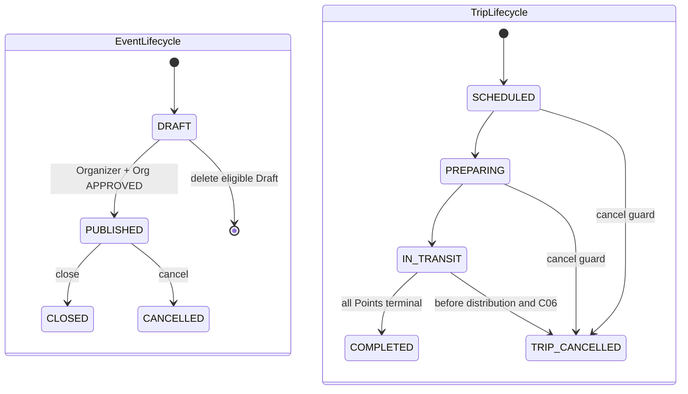
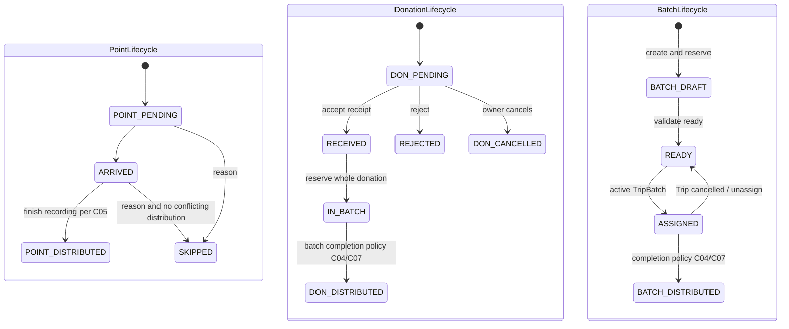

# 06 Business and Data Flow Diagrams

## Phân biệt ba loại hình

Activity diagram biểu diễn bước, quyết định, nhánh lỗi và vai trò thực hiện. DFD biểu diễn dữ liệu đi giữa external entity, process và data store; không dùng DFD để thay state machine. State diagram biểu diễn trạng thái hợp lệ của một entity. Các luồng dưới đây là thiết kế MVP theo proposal; backend hiện chưa thực thi workflow.

## B01 Organization và Event

Swimlane: Registered User → Platform Admin → Organizer → OpenAid/Database.

1. User gửi hồ sơ Organization; hệ thống tạo PENDING và membership ORGANIZER cùng transaction/log.
2. Admin xem và APPROVED hoặc REJECTED; SUSPENDED dùng cho đình chỉ theo schema.
3. Organizer tạo Event DRAFT, thêm VolunteerRole và DonationNeed dùng catalog chuẩn.
4. Khi publish, kiểm tra user là ORGANIZER của chính organizationId và tổ chức APPROVED.
5. DRAFT → PUBLISHED, ghi log; Event mới xuất hiện trong discovery công khai.
6. Kết thúc Event: CLOSED hoặc CANCELLED theo điều kiện; giữ lịch sử, không xóa Published Event có liên kết.

Ngoại lệ: thiếu quyền, tổ chức chưa duyệt, thời gian không hợp lệ, dữ liệu role/need không hợp lệ → không publish; trả lỗi nghiệp vụ và không ghi một nửa dữ liệu.

## B02 Volunteer

Swimlane: Visitor/Volunteer → Organizer → OpenAid/Database.

Application status không biến thành CHECKED_IN/COMPLETED: schema tách Attendance. Một user có tối đa một application trong một Event. Nếu số application APPROVED có thể vượt role.quantity, quy tắc nhận thêm phải chốt theo C02; schema không có counter approvedQuantity.

## B03 Donation đến công khai

Swimlane: Donor → Organizer → Trip Leader/Member → Organizer Review → Visitor.

Cảnh báo vượt target không được thay thành lỗi cấm donation. Donation đã received tiếp tục nằm trong tổng Pledged theo định nghĩa “registered and not rejected/cancelled”, đồng thời được tính Received; hai chỉ số không phải các nhóm cộng dồn vào một tổng.

Các điều kiện đánh dấu Batch/Donation DISTRIBUTED khi có hàng trả/mất hoặc evidence chưa đủ cần chốt C04/C07. Việc review ảnh không tự tăng/giảm số lượng đã giao thực tế.

## B04 Trip và Distribution

1. Organizer chọn Event; nhập departurePoint, departureDate, vehicle tùy chọn.
2. Chọn các Batch READY cùng Event, không có active TripBatch khác.
3. Chọn Application APPROVED cùng Event; đúng một TripVolunteer LEADER.
4. Khai báo Points với position duy nhất; tạo Trip SCHEDULED, TripBatch active, Points PENDING; Batch ASSIGNED; không đổi stock.
5. Organizer/Leader chuyển PREPARING → IN_TRANSIT.
6. Đến Point: PENDING → ARRIVED.
7. Nhập từng DistributionRecord theo TripBatch và Point; kiểm tra tổng đã phát và phần đang đối soát không vượt Batch.quantity.
8. Hoàn tất ghi nhận tại Point rồi đánh dấu DISTRIBUTED; hoặc SKIPPED với lý do. Nhiều batch tại một Point cần điều kiện hoàn tất theo C05.
9. Upload evidence; privacy confirmation và Organizer review quyết định quyền công khai.
10. Đối soát phần dư/returned/lost theo Batch; ghi note và stock tương ứng.
11. Complete Trip khi mọi Point DISTRIBUTED hoặc SKIPPED. Điều kiện bằng chứng/đối soát bổ sung cần chốt C04/C07.

Nhánh hủy: trước khi có Point DISTRIBUTED, kiểm tra thêm dữ liệu giao thực tế theo C06; transaction đặt CANCELLED, điền TripBatch.unassignedAt, Batch về READY, log từng unassignment. Kho vẫn Reserved. Có thể lập Trip khác dùng Batch đó; không xóa lịch sử Trip cũ.

## Data stores cho DFD

| ID  | Store logic                 | Các bảng hiện tại                                          |
| --- | --------------------------- | ---------------------------------------------------------- |
| D1  | Accounts and Organizations  | User, Organization, OrganizationMember                     |
| D2  | Events and Needs            | Event, VolunteerRole, DonationNeed, ItemType, Unit         |
| D3  | Volunteer Participation     | VolunteerApplication, VolunteerAttendance, TripVolunteer   |
| D4  | Donations and Inventory     | Donation, Inventory, Batch                                 |
| D5  | Trips and Distribution      | Trip, TripBatch, DistributionPoint, DistributionRecord     |
| D6  | Evidence Metadata and Audit | Evidence, TransparencyLog                                  |
| D7  | Evidence Files              | Local directory/Object Storage, không phải bảng PostgreSQL |

D1–D6 là các nhóm logic trong cùng PostgreSQL, không phải sáu database riêng.

## DFD level 1

| Process                              | Input từ actor/process                                       | Store đọc                   | Store ghi             | Output                                                |
| ------------------------------------ | ------------------------------------------------------------ | --------------------------- | --------------------- | ----------------------------------------------------- |
| P1 Manage Identity and Organizations | Credentials, profile, hồ sơ và quyết định Admin              | D1                          | D1, D6                | Session/JWT, profile, Organization status             |
| P2 Manage Event and Participation    | Event/role/need, application/review, attendance              | D1, D2, D3                  | D2, D3, D6            | Discovery, My Activities, approved list               |
| P3 Manage Donation and Stock         | Need, donation, receipt, selected donationIds                | D1, D2, D4                  | D4, D6                | Tracking ID, stock, Batch                             |
| P4 Coordinate Distribution           | Trip plan, assignments, Point updates, quantities, reconcile | D1, D3, D4, D5              | D3, D4, D5, D6        | Trip progress, Records, stock changes                 |
| P5 Manage Evidence                   | File, caption, privacy confirmation, Organizer decision      | D1, D5, D6                  | D6, D7                | Pending metadata, review status, allowed image access |
| P6 Publish Transparency and Reports  | Tracking ID hoặc Event/report request                        | D1–D6; D7 qua URL được phép | Không có Report store | Public projection/timeline hoặc scoped summary        |

DFD không nối actor trực tiếp vào store. Mỗi process phải có dữ liệu vào và ra; nhãn process là động từ, nhãn data flow là danh từ/dữ liệu.

## State machine

Các enum tồn tại trong schema; các transition dưới đây là yêu cầu/thiết kế, chưa có state machine được code trong service.

Application: PENDING → APPROVED/REJECTED. Attendance: no row → checkedInAt → checkedOutAt. Evidence review: PENDING → APPROVED/REJECTED; quyền sửa/review lại chưa chốt. Organization có enum PENDING/APPROVED/REJECTED/SUSPENDED; quy trình resubmit/reinstate chưa được chốt trong proposal, không tự vẽ các cạnh trở lại.

## Stock và kịch bản demo

Đối với một Event + loại hàng + đơn vị, luôn có:
`Received = Available + Reserved + Distributed + Lost`.

| Bước                               | Received | Available | Reserved | Distributed | Lost |
| ---------------------------------- | -------: | --------: | -------: | ----------: | ---: |
| Đăng ký 20 + 50 + 30 kg gạo        |        0 |         0 |        0 |           0 |    0 |
| Organizer nhận đủ 100 kg           |      100 |       100 |        0 |           0 |    0 |
| Gom Batch 100 kg                   |      100 |         0 |      100 |           0 |    0 |
| Gán Trip, rồi Preparing/In Transit |      100 |         0 |      100 |           0 |    0 |
| Point A nhận 40 kg                 |      100 |         0 |       60 |          40 |    0 |
| Point B nhận 60 kg                 |      100 |         0 |        0 |         100 |    0 |
| Review ảnh/tạo báo cáo             |      100 |         0 |        0 |         100 |    0 |

Kịch bản đối soát bổ sung: sau khi phát 80 kg, trả 15 kg và mất 5 kg → Received 100, Available 15, Reserved 0, Distributed 80, Lost 5. Không ghi “100 kg đã phát”. Remaining được suy ra từ Batch.quantity trừ Records, returnedQuantity và lostQuantity; schema không có cột remainingQuantity.

Kịch bản hủy trước phát: sau reserve 100 và assign Trip A, hủy A → Received 100, Available 0, Reserved 100; Batch READY. Gán Trip B vẫn giữ các số đó. Không receive hoặc reserve lần nữa.

Dashboard tách Needed 500 kg, Pledged 100 kg, Received 100 kg và Distributed theo thực tế. Cần một dòng riêng cho water/bottle; không cộng các đơn vị khác nhau. Đây là demo mục tiêu từ proposal 14, không phải bộ seed end-to-end đã có.
