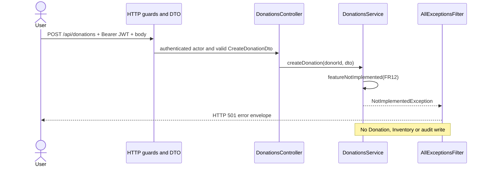
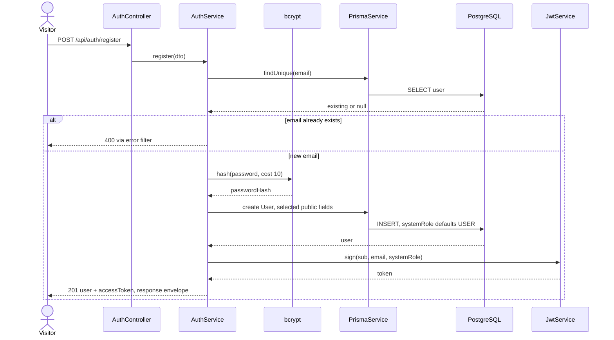
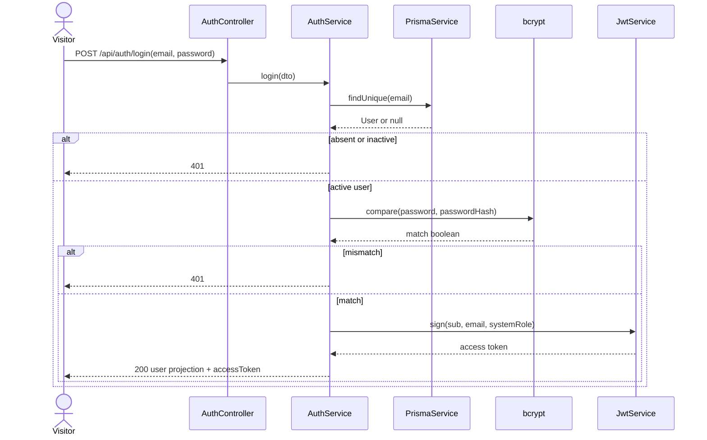
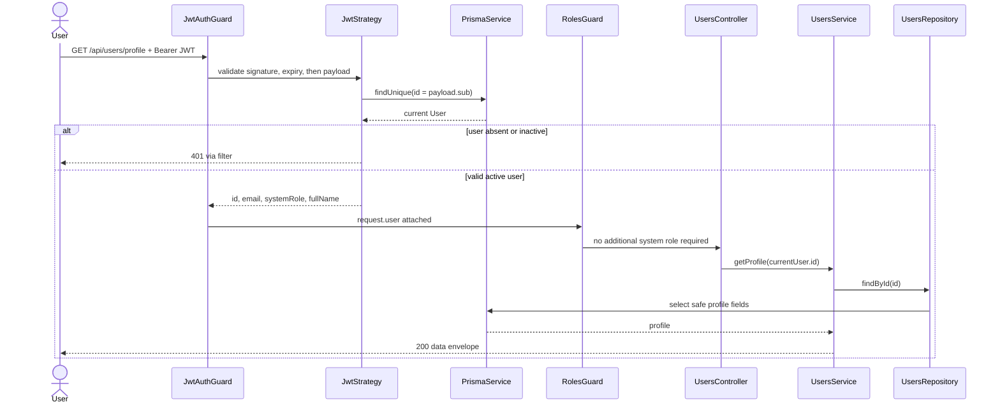
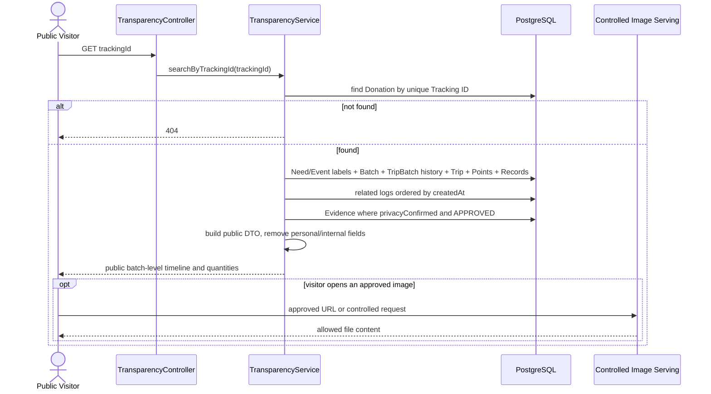

# 07 Sequence Diagrams

## Cách đọc

SEQ01–SEQ02 mô tả logic đã có ở backend. SEQ00 minh họa response của domain scaffold hiện tại. SEQ03–SEQ13 là **THIẾT KẾ MVP** dựa vào proposal, schema và hợp đồng controller/DTO; các lời gọi kiểm tra/transaction trong các hình này chưa được code.

Với request được bảo vệ, bước chung là JWT signature/expiry → tìm User hiện tại trong database → kiểm tra active → RolesGuard khi có @Roles → DTO → controller → service. Ngoại lệ 401/403/400 đi qua AllExceptionsFilter. Các bước kiểm tra Organizer/Leader ở nghiệp vụ là bổ sung cho global guard.

Lifeline “Repository/Prisma” gộp lớp truy cập dữ liệu để hình vừa trang; nó không phải một tiến trình riêng. BEGIN/COMMIT/ROLLBACK là transaction logic của cùng PostgreSQL. Ghi audit phải dùng cùng TransactionClient. Tên helper kiểm tra/stock chưa có trong code được hiểu là trách nhiệm dự kiến.

## SEQ00 Domain scaffold hiện tại

Áp dụng ví dụ POST /api/donations sau khi JWT và DTO hợp lệ.



Hình này giúp phân biệt sequence hiện trạng với sequence nghiệp vụ đích.

## SEQ01 Register và Login — logic hiện có

Nguồn: AuthController/AuthService. Register nhận email/fullName/password/phoneNumber tùy chọn; systemRole không nhận từ client. Duplicate email hiện trả BadRequestException (400). Login trả 401 nếu không có user, inactive hoặc sai password.





Không thêm OAuth server, refresh-token service hoặc Redis blacklist vào sequence này: hiện không có. Session trong frontend prototype hiện lưu user id bằng localStorage, chưa phải cơ chế tích hợp JWT thật; C01 cần chốt.

## SEQ02 Protected profile — logic hiện có



Với route Admin, RolesGuard kiểm tra systemRole hiện lấy từ DB, không tin role cũ trong JWT để cấp quyền. Với profile update, actor id cũng lấy từ JWT, không nhận userId tùy ý từ body.

## SEQ03 Organization approval và publish Event — dự kiến

UC05/07/08/09/10/11, FR03–FR06/20/24. Cần tách thành các lần người dùng thao tác, không coi là một request kéo dài đợi Admin.

```mermaid
sequenceDiagram
  actor U as Registered User
  actor A as Admin
  actor O as Organizer
  participant OS as OrganizationsService
  participant AS as AdminService
  participant ES as EventsService
  participant AC as OrganizationAccessService
  participant DB as PostgreSQL
  U->>OS: createOrganization(actor, dto)
  OS->>DB: BEGIN; Organization PENDING + member ORGANIZER + log
  DB-->>OS: COMMIT
  OS-->>U: Organization pending
  Note over U,A: Separate later action
  A->>AS: reviewOrganization(actor, id, APPROVED)
  AS->>DB: BEGIN; update Organization + log
  DB-->>AS: COMMIT
  Note over A,O: Separate later action
  O->>ES: createEvent(actor, roles and donationNeeds)
  ES->>AC: requireOrganizer(actor.id, resolved organizationId)
  AC-->>ES: authorized or 403
  ES->>DB: BEGIN; Event DRAFT + roles + needs + log
  DB-->>ES: COMMIT
  O->>ES: changeStatus(id, PUBLISHED)
  ES->>AC: requireApprovedOrganizer
  AC-->>ES: organizer membership + Org APPROVED
  ES->>DB: BEGIN; verify DRAFT; PUBLISHED + log
  DB-->>ES: COMMIT
  ES-->>O: published Event
```

Bất kỳ lỗi quyền, dữ liệu hoặc log nào phải ngăn/rollback thao tác DB tương ứng. Không rollback Organization đã duyệt chỉ vì thao tác tạo Event sau đó thất bại; đó là hai transaction khác nhau.

## SEQ04 Volunteer apply, review và attendance — dự kiến

Payload apply: eventId, volunteerRoleId, notes?. Review chỉ nhận APPROVED/REJECTED. Check-in/out là hai endpoint riêng.

```mermaid
sequenceDiagram
  actor V as Volunteer
  actor O as Organizer
  participant S as VolunteersService
  participant AC as OrganizationAccessService
  participant DB as PostgreSQL
  V->>S: registerVolunteer(currentUser.id, dto)
  S->>DB: load Event/Role and check no duplicate application
  S->>DB: BEGIN; create PENDING + log; COMMIT
  S-->>V: application id and status
  O->>S: reviewApplication(actor, id, dto)
  S->>DB: resolve application Event and Organization
  S->>AC: requireOrganizer for resolved organization
  alt rejected
    S->>DB: BEGIN; REJECTED + log; COMMIT
    S-->>V: status visible in My Activities
  else approved
    S->>DB: BEGIN; verify capacity policy C02; APPROVED + log; COMMIT
    V->>S: checkIn(actor, applicationId)
    S->>DB: verify attendance permission and APPROVED
    S->>DB: BEGIN; create Attendance.checkedInAt + log; COMMIT
    V->>S: checkOut(actor, applicationId)
    S->>DB: BEGIN; checkout after checkin + log; COMMIT
  end
```

Ai có quyền xác nhận attendance được ghi theo C02; sơ đồ dùng Volunteer thao tác là lựa chọn dự kiến, không khẳng định đã có cơ chế chống tự check-in. Không chuyển Application sang COMPLETED vì enum hiện không có giá trị này.

## SEQ05 Create Donation và Tracking ID — dự kiến

POST /api/donations; body: donationNeedId, quantity. Client không gửi donorId, item type/unit hay tổng pledged để hệ thống tin trực tiếp.

```mermaid
sequenceDiagram
  actor D as Donor
  participant C as DonationsController
  participant S as DonationsService
  participant ID as Tracking ID helper
  participant DB as PostgreSQL
  D->>C: create donation with valid JWT
  C->>S: createDonation(currentUser.id, dto)
  S->>DB: resolve Need -> Event, ItemType, Unit
  S->>DB: verify Event accepts donations; query pledged total
  S->>ID: generate random non-sequential code
  ID-->>S: tracking candidate
  S->>DB: BEGIN; INSERT Donation PENDING + audit
  alt unique Tracking ID collision
    DB-->>S: rollback / unique violation
    S->>ID: regenerate and retry according to C12
  else valid unique insert
    DB-->>S: COMMIT
    opt pledged total exceeds target
      S->>S: attach warning, still successful
    end
    S-->>D: Donation + Tracking ID + optional warning
  end
```

Điều kiện Event nhận application/donation ở CLOSED/CANCELLED phải kiểm tra trong service; scaffold chưa thực thi. Retry phải có giới hạn và xử lý lại transaction đúng cách, không tiếp tục một PostgreSQL transaction đã lỗi.

## SEQ06 Confirm receipt — dự kiến

PATCH /api/donations/:id/receipt; ReceiveDonationDto.status RECEIVED hoặc REJECTED. Nhánh nhận thành công là UC19.

```mermaid
sequenceDiagram
  actor O as Organizer
  participant S as DonationsService
  participant AC as OrganizationAccessService
  participant DB as PostgreSQL
  participant LOG as TransparencyRepository
  O->>S: receiveDonation(actor, id, dto)
  S->>DB: load Donation -> Event -> Organization
  S->>AC: requireOrganizer(actor, resolved organization)
  S->>DB: BEGIN; lock or conditionally update PENDING Donation
  alt rejection
    S->>DB: set REJECTED and reason; no stock increase
    S->>LOG: append(tx, old PENDING, new REJECTED, actor)
    LOG->>DB: INSERT audit
  else receipt accepted
    S->>DB: set RECEIVED and receivedAt
    S->>DB: upsert Inventory by Event/type/unit
    S->>DB: Received += q; Available += q
    S->>LOG: append(tx, old PENDING, new RECEIVED, actor)
    LOG->>DB: INSERT audit
  end
  alt all writes valid
    DB-->>S: COMMIT
    S-->>O: updated Donation and quantities
  else invalid state, concurrency or failed write
    DB-->>S: ROLLBACK
    S-->>O: domain error; no partial receipt/stock/log
  end
```

Request lặp không được nhập kho lần hai; trả trạng thái hiện tại hay 409 cần chốt C10. Chưa có idempotency-key table/header trong code.

## SEQ07 Create Batch và reserve — dự kiến

POST /api/batches; body eventId và donationIds không rỗng, không trùng. Quantity phải được tính bằng Decimal từ whole donations, không nhận số lượng lô tùy ý.

```mermaid
sequenceDiagram
  actor O as Organizer
  participant S as BatchesService
  participant AC as OrganizationAccessService
  participant DB as PostgreSQL
  participant LOG as TransparencyRepository
  O->>S: createBatch(actor, eventId, donationIds)
  S->>DB: resolve Event organization
  S->>AC: requireOrganizer
  S->>DB: BEGIN; lock/claim selected Donations and Inventory
  S->>S: verify RECEIVED, no Batch, same Event/type/unit
  S->>S: sum quantities using Decimal
  S->>DB: conditional Available -= q; Reserved += q
  S->>DB: INSERT Batch DRAFT; attach Donation.batchId and IN_BATCH
  S->>LOG: append(tx, Batch creation and Donation changes)
  LOG->>DB: INSERT logs
  alt all valid and enough Available
    DB-->>S: COMMIT
    S-->>O: Batch and stock snapshot
  else mixed goods/Event, already assigned or insufficient stock
    DB-->>S: ROLLBACK
    S-->>O: conflict or validation error
  end
```

Chuyển DRAFT → READY là request riêng. Batch DRAFT ở thiết kế scaffold đã giữ Reserved, nên thao tác bỏ một Draft Batch cần được chốt nếu sau này bổ sung; hiện chưa có delete/cancel Batch endpoint.

## SEQ08 Create Trip — dự kiến

CreateTripDto: eventId, departurePoint/date, vehicle?, batchIds[], volunteers[{applicationId,role}], points[{position,name,location,mapUrl?}].

```mermaid
sequenceDiagram
  actor O as Organizer
  participant S as TripsService
  participant AC as OrganizationAccessService
  participant DB as PostgreSQL
  participant LOG as TransparencyRepository
  O->>S: createTrip(actor, dto)
  S->>DB: resolve Event -> Organization
  S->>AC: requireOrganizer
  S->>DB: BEGIN; read/claim selected Batches and Applications
  S->>S: validate same Event, READY batches, APPROVED applications
  S->>S: validate exactly one Leader, unique members and point positions
  S->>DB: INSERT Trip SCHEDULED
  S->>DB: INSERT TripVolunteer, TripBatch active and Points PENDING
  S->>DB: set selected Batches ASSIGNED
  S->>LOG: append(tx, Trip/assignments/status logs)
  LOG->>DB: INSERT logs
  alt active-assignment or Leader index conflict / invalid input
    DB-->>S: ROLLBACK
    S-->>O: error
  else valid plan
    DB-->>S: COMMIT
    S-->>O: Trip plan, stock unchanged
  end
```

unique index “tối đa một Leader” không thay kiểm tra “đúng một”. Trip assignment không thực hiện lại thao tác Available → Reserved.

## SEQ09 Point và distributed quantity — dự kiến

Point status: PATCH /api/distribution/points/:id/status. Record: POST /api/distribution/records(tripBatchId, distributionPointId, distributedQuantity, beneficiaryCount?, notes?).

```mermaid
sequenceDiagram
  actor L as Organizer or Trip Leader
  participant S as DistributionService
  participant DB as PostgreSQL
  participant LOG as TransparencyRepository
  L->>S: updatePoint(actor, pointId, ARRIVED)
  S->>DB: resolve Trip/Event and check Organizer or assigned Leader
  S->>DB: BEGIN; verify Point PENDING; ARRIVED + audit; COMMIT
  L->>S: createDistribution(actor, dto)
  S->>DB: BEGIN; lock Batch/stock and read TripBatch + Point
  S->>S: verify same Trip, active assignment and allowed Trip/Point state
  S->>DB: aggregate previous quantities per Batch
  S->>S: check new distributed + returned + lost <= Batch.quantity
  S->>DB: INSERT Record with confirmedById
  S->>DB: Reserved -= q; Distributed += q
  S->>LOG: append(tx, distribution and quantity change)
  LOG->>DB: INSERT log
  alt any invariant fails
    DB-->>S: ROLLBACK
    S-->>L: quantity/state/permission conflict
  else success
    DB-->>S: COMMIT
    S-->>L: Record and current totals
  end
  Note over L,S: Point completion after all required records follows C05
  L->>S: updatePoint(actor, pointId, DISTRIBUTED)
  S->>DB: validate completion; status + audit in transaction
```

Không cho Member xác nhận quantity. Không cho một record của Trip A dùng Point của Trip B; composite FK hỗ trợ ràng buộc này. Sau Point DISTRIBUTED, quy trình sửa số lượng đã xác nhận chưa có trong MVP contract.

## SEQ10 Cancel Trip — dự kiến

PATCH /api/trips/:id/status với CANCELLED. Giữ đầy đủ lịch sử canceled assignment.

```mermaid
sequenceDiagram
  actor L as Organizer or Trip Leader
  participant S as TripsService
  participant DB as PostgreSQL
  participant LOG as TransparencyRepository
  L->>S: updateTrip(actor, tripId, CANCELLED)
  S->>DB: resolve scope; authorize Organizer/Leader
  S->>DB: BEGIN; lock Trip and active assignments
  S->>DB: read Points and distribution Records
  alt already distributed or prohibited by C06
    DB-->>S: ROLLBACK
    S-->>L: cancellation rejected
  else eligible to cancel
    S->>DB: Trip -> CANCELLED
    loop each active TripBatch
      S->>DB: set unassignedAt; Batch ASSIGNED -> READY
      S->>LOG: append(tx, Batch unassignment, actor, old/new)
      LOG->>DB: INSERT log
    end
    S->>LOG: append(tx, Trip cancellation)
    LOG->>DB: INSERT log
    DB-->>S: COMMIT
    S-->>L: canceled; stock remains Reserved
  end
```

Hủy không xóa Donation.batchId, không tăng Available và không xóa các bảng assignment. Trip mới có thể dùng Batch READY sau khi assignment cũ đã unassigned.

## SEQ11 Evidence upload và Organizer review — dự kiến

Endpoint POST /api/evidence hiện chỉ có metadata DTO, chưa có multipart interceptor/file parameter. Hình này là thiết kế upload cần xây dựng. Xác nhận privacy phải có trước khi nhận/lưu ảnh, dù bước hiển thị UI có thể trình bày cạnh thao tác upload.

```mermaid
sequenceDiagram
  actor M as Assigned Member or Organizer
  actor O as Organizer
  participant S as EvidenceService
  participant F as FileStorage
  participant DB as PostgreSQL
  participant LOG as TransparencyRepository
  M->>S: metadata + image file + privacyConfirmed true
  S->>DB: resolve Trip/Point; verify assignment or Organizer
  S->>S: validate type, magic bytes, <=5 MiB and privacy confirmation
  S->>F: save private file
  F-->>S: key, URL, MIME and size
  S->>DB: BEGIN; INSERT Evidence PENDING with uploader/point/metadata
  S->>LOG: append(tx, evidence uploaded)
  LOG->>DB: INSERT log
  alt DB commit fails
    DB-->>S: ROLLBACK
    S->>F: remove just-uploaded file or schedule cleanup
    S-->>M: error; no public evidence
  else metadata committed
    DB-->>S: COMMIT
    S-->>M: uploaded, awaiting review
  end
  Note over M,O: Separate review action
  O->>S: reviewEvidence(actor, id, APPROVED or REJECTED)
  S->>DB: verify Organizer of Evidence Event
  S->>DB: BEGIN; update review status, reviewedById/time/note
  S->>LOG: append(tx, evidence review)
  LOG->>DB: INSERT log
  DB-->>S: COMMIT
  Note over S,F: Public access must follow approval gate C03
```

Object storage và PostgreSQL không chung một ACID transaction; không vẽ “BEGIN” bao trùm cả hai và cho rằng DB rollback sẽ xóa file. Storage key chưa có cột riêng trong Evidence hiện tại; cách map key/URL và phục vụ ảnh phải chốt C03 trước khi implement.

## SEQ12 Public Tracking — dự kiến

GET /api/transparency/track/:trackingId, không login. Không dùng current user hoặc mock session làm điều kiện được tra cứu.



Giữ canceled Trip trong lịch sử và phân biệt assignment đã unassigned; không chỉ lấy một “Trip hiện tại” làm mất dấu. Loại donorId/password/contact/volunteer identity, actor names của log nội bộ, reconciliation notes nhạy cảm và ảnh chưa duyệt khỏi public DTO. Chỉ hiện lượng phát của Batch tại từng Point, không gán vật lý phần hàng của từng donor tới một Point.

Nếu cần snapshot nhất quán khi đang có cập nhật, chọn transaction/read strategy phù hợp; không nhất thiết mọi public query phải là transaction ghi.

## SEQ13 Reconcile, complete và Dashboard — dự kiến

POST /api/batches/:id/reconcile nhận returnedQuantity, lostQuantity, note. PATCH Trip COMPLETED có điều kiện tất cả Points terminal. GET /api/dashboard/events/:eventId tổng hợp theo scope.

```mermaid
sequenceDiagram
  actor O as Organizer
  participant B as BatchesService
  participant T as TripsService
  participant R as DashboardService
  participant DB as PostgreSQL
  participant LOG as TransparencyRepository
  O->>B: reconcileBatch(actor, id, returned, lost, note)
  B->>DB: authorize; BEGIN; lock Batch/Inventory
  B->>DB: aggregate distributed; validate remaining and C07
  B->>DB: Reserved -= returned + lost; Available += returned; Lost += lost
  B->>DB: persist per-Batch reconciliation and note
  B->>LOG: append(tx, quantity reconciliation)
  LOG->>DB: INSERT log
  DB-->>B: COMMIT
  O->>T: updateTrip(actor, id, COMPLETED)
  T->>DB: authorize; BEGIN; verify all Points Distributed/Skipped
  T->>T: check additional completion/evidence policy C04/C07
  T->>DB: set completion statuses + completedAt + audit
  DB-->>T: COMMIT
  O->>R: getOverviewStats(actor, eventId)
  R->>DB: verify scope; query needs, donations, stock, batches, trips, volunteers
  DB-->>R: aggregate rows by item type and unit
  R-->>O: Needed / Pledged / Received / Distributed / Lost / Returned details
```

Reconcile input cần chốt là cumulative totals hay incremental adjustment để retry không cộng trả/mất nhiều lần; xem C07/C10. Với partial/lost/returned, không tự đặt mọi donation thành DISTRIBUTED mà không có chính sách đã chốt. Final Report là kết quả query, không INSERT một Report entity.

## Những hình bổ sung có thể tách khi làm SRS

Event Discovery read, My Activities, My Donations và Admin list là các query theo actor/scope; có thể dựng từ pattern controller → service → scoped query → projection. Admin moderation và donation photo upload chưa có contract đủ chi tiết, được ghi ở phần 09 thay vì vẽ như chức năng đã code.
