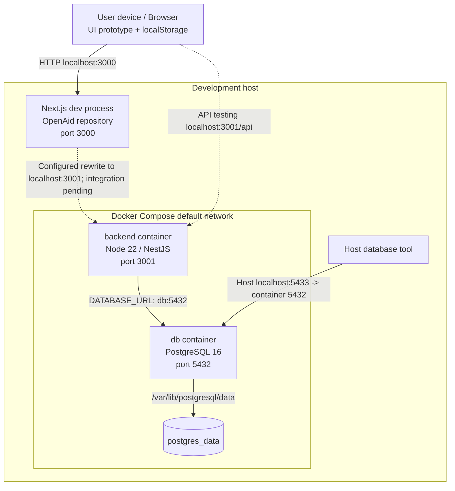
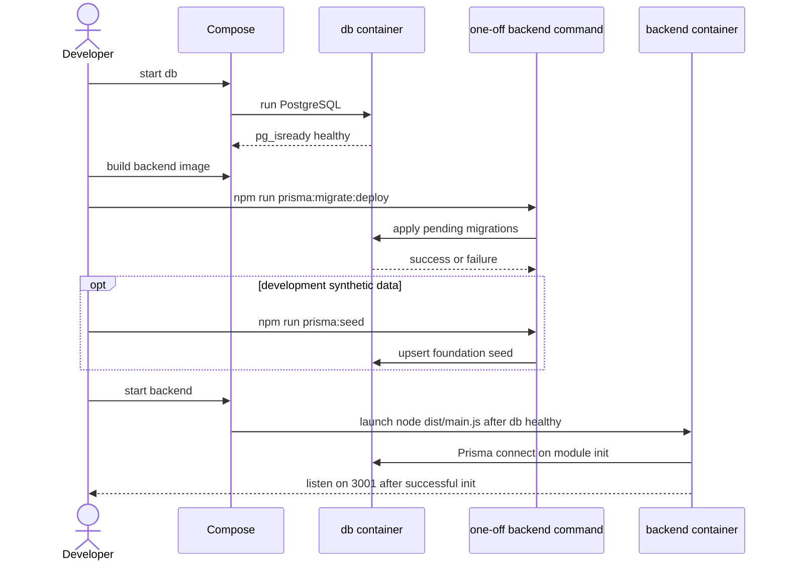
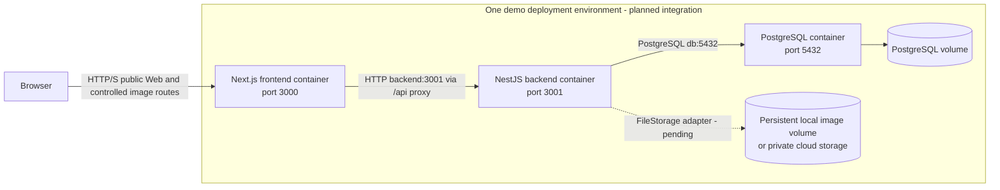

# 08 Deployment Diagram

## Phạm vi và nguồn

Nguồn hiện có: [Compose](../../compose.yaml), [Dockerfile](../../Dockerfile), [bootstrap](../../src/bootstrap.ts), [Prisma config](../../prisma.config.ts), [CI](../../.github/workflows/ci.yml), frontend `../OpenAid/next.config.ts` và `package.json`.

Cấu hình triển khai có trong source không chứng minh môi trường đang chạy. Không đưa hostname/IP/domain thật vào sơ đồ khi chưa có quyết định triển khai.

## Node/container hiện tại

| ID    | Node/artifact                | Nội dung                                                                   | Cổng/persistence                                         | Trạng thái                                                   |
| ----- | ---------------------------- | -------------------------------------------------------------------------- | -------------------------------------------------------- | ------------------------------------------------------------ |
| DEP01 | User device                  | Browser                                                                    | HTTP đến FE; localStorage chứa mock/session hiện tại     | FE prototype                                                 |
| DEP02 | Frontend development process | Next.js app trong ../OpenAid                                               | Next dev mặc định 3000; rewrite /api tới BACKEND_API_URL | Có source/script; không có service frontend trong Compose BE |
| DEP03 | Docker host                  | Docker Engine / Compose project                                            | Default Compose network                                  | Cấu hình có                                                  |
| DEP04 | backend container            | Node 22 bookworm-slim, dist, node_modules, Prisma schema/config/migrations | Host PORT mặc định 3001 → container 3001                 | Có Dockerfile/Compose                                        |
| DEP05 | db container                 | postgres:16-alpine                                                         | Host DB_PORT mặc định 5433 → container 5432              | Có Compose                                                   |
| DEP06 | postgres_data volume         | PostgreSQL data                                                            | /var/lib/postgresql/data                                 | Named volume trong Compose                                   |
| DEP07 | GitHub Actions runner        | Ubuntu, Node 22, npm checks                                                | Không triển khai runtime service                         | Workflow kiểm tra có trong source                            |

Compose tạo network mặc định cho backend và db. Backend kết nối hostname `db:5432`, không dùng `localhost:5433` trong container. Cổng 5433 là đường từ host để debug/công cụ quản trị; nó không phải đường backend → db.

Frontend hiện chưa containerized trong hai thư mục đã kiểm tra. Trong local prototype, browser data dùng localStorage; API rewrite chỉ là cấu hình có sẵn.

## Hình deployment hiện có

## Image build và runtime artifact

- Stage base: node:22-bookworm-slim + openssl.
- Stage build: copy package/lock/Prisma config/.npmrc/schema; npm ci; copy src/tsconfig; npm run build.
- prebuild chạy prisma generate; client nằm trong node_modules, không cần dist/generated.
- Stage runtime: copy dependencies, dist, prisma và config/package; NODE_ENV=production; chạy user node; command node dist/main.js; expose 3001.
- Image prototype giữ cả Prisma CLI để chạy migration bằng one-off command.
- Không có frontend build, image registry push hay object storage provisioning trong Dockerfile này.

## Startup sequence cần thể hiện

depends_on chỉ kiểm tra DB healthy, không tự apply migration. Migration phải thành công trước khi chạy luồng cần bảng; seed là bước tùy chọn cho development. Chưa có migration job service riêng trong Compose.

GET /api/health/live là liveness trả status ok khi app đã boot; không truy vấn database mỗi lần, không được ghi thành “continuous DB readiness check”.

## Deployment đích MVP

Ảnh đi qua HTTP serving được phép; browser không truy cập trực tiếp volume trên host. Nếu dùng cloud storage và signed URL thì bổ sung đường HTTPS riêng sau khi chốt C03.

Frontend service/container và upload storage trong hình này là THIẾT KẾ MVP, chưa có Compose tương ứng. Khi chạy frontend trong Docker, localhost trong Next server là chính container frontend: BACKEND_API_URL phải trỏ tới hostname backend phù hợp. next.config.ts tạo rewrite từ biến môi trường khi cấu hình/build được nạp, nên cần cấp biến đúng vào giai đoạn build/run được chọn và kiểm tra artifact.

Nếu chọn một server public, cần chốt domain/TLS/ingress ở C09; hiện không có Nginx, load balancer, cloud host hoặc certificate manager trong source. Không vẽ những công nghệ này như đã được chọn.

Local image volume chưa tồn tại trong Compose. Nếu chọn local storage trong container, phải thêm mount bền vững và quyền ghi cho user node; nếu cloud, chốt provider, private/public access và URL serving ở C03. Không vẽ PostgreSQL volume như nơi chứa byte ảnh.

## CI và quy trình thay đổi

GitHub push/PR → Ubuntu runner → checkout → Node 22/npm cache → npm ci → prisma validate → build → lint → unit tests → scaffold E2E smoke tests.

Đây là **CI kiểm tra**, chưa có tự động build/push Docker image hoặc deploy. Bộ smoke test thay Prisma bằng mock; workflow không tạo PostgreSQL service và không chứng minh migration/workflow thật đã chạy.

Theo CONTRIBUTING.md, code đi qua nhánh công việc và PR vào main. Việc branch protection/ruleset có bật hay không không thể kết luận từ file Markdown; không đặt “protected main enforced” vào sơ đồ hiện trạng nếu chưa kiểm tra GitHub repository.

## Biến cấu hình nên ghi chú

PORT, DATABASE_URL, JWT_SECRET, JWT_EXPIRES_IN, FRONTEND_URL ở backend; POSTGRES_USER/PASSWORD/DB và DB_PORT ở Compose; BACKEND_API_URL ở Next.js rewrite. Trên hình chỉ ghi tên biến và default port, không chèn secret hoặc URL có mật khẩu.
